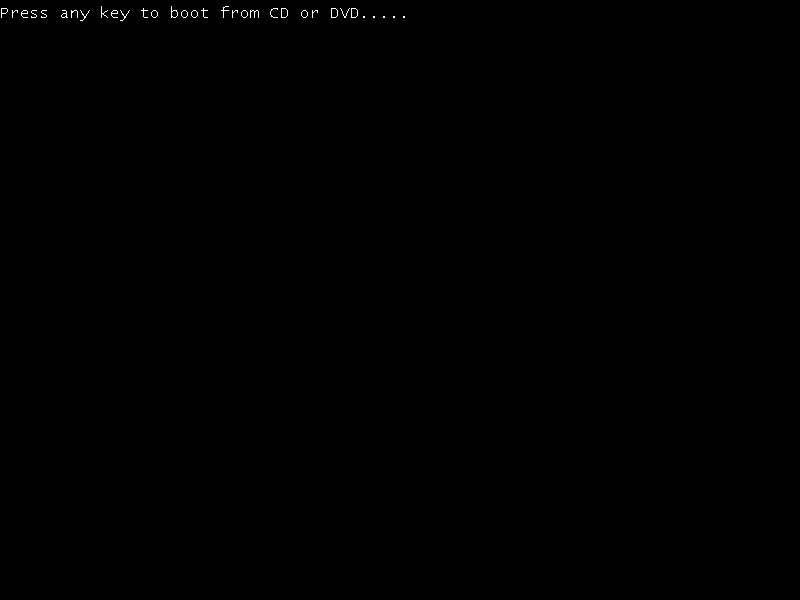

# Offline Microsoft ARM64 DBX provisioning

The independent firmware enrollment script now replaces virt-firmware's placeholder DBX with Microsoft's ARM64 factory hash database. This prepares a template for **new VMs**. It does not alter any existing VM, EFI variable store, disk, running firmware or installed application. A VM keeps the private EFI variables copied when it was created; changing a packaged template does not migrate that VM.

## Sources and exact scope

The source lock is [scripts/secure-boot-dbx-sources.json](../scripts/secure-boot-dbx-sources.json). On 2026-10-15, Microsoft's latest published releases were [v1.7.0](https://github.com/microsoft/secureboot_objects/releases/tag/v1.7.0) and [v1.7.0-signed](https://github.com/microsoft/secureboot_objects/releases/tag/v1.7.0-signed), released on 2026-09-03 at commit `9a2bbf82e86b62694e44aba3a4068d8dd0c943d7`. Sources are pinned; builds do not silently follow a moving `latest` URL.

The selected `LegacyFirmwareDefaults/Firmware/DefaultDbx.bin` from Microsoft's aarch64 firmware archive contains **26 SHA-256 image revocations**. The script checks the archive's published SHA-256, the exact ESL payload hash, Microsoft's per-file receipt, each signature owner, and every ARM64 hash against the repository's pinned human-readable source. It never installs certificates from the archive's PK, KEK or db files. Existing independently enrolled PK, KEK, db and every other variable retain exactly the same attributes, GUIDs, data and timestamps across DBX replacement.

The separately downloaded `SignedByKEK2023/dbx_aarch64.efiauth2` update contains **22** of those hashes. The four additional factory hashes revoke specific Windows 10 version 1507 BlackLotus-related images and are marked optional in Microsoft's source receipt. The complete 26-entry factory ESL is an unsigned firmware-default object; it is **not** represented as a fully signed runtime update. Its provenance is the pinned Microsoft release and receipts. The 22-entry Auth2 signature and signer chain are verified separately against the exact Microsoft KEK 2023 certificate already in the generated store. These profiles follow Microsoft's distinction between [factory defaults and signed runtime objects](https://github.com/microsoft/secureboot_objects/wiki/Manufacturing-And-Operating-System-Instructions).

This profile does not add certificate-wide Windows Production PCA 2011 revocation or Windows SVN policy updates. Those are separate compatibility-sensitive operations. Hash-based DBX provisioning alone is not a claim of complete Secure Boot security, Windows servicing readiness, or protection against every known boot vulnerability.

## Authentication verification

OpenSSL 3 verifies CMS over the UEFI-authenticated byte sequence: UTF-16LE `dbx` name, image-security database GUID, append attributes `0x67`, the original EFI timestamp, and the signed ESL payload. Microsoft's bare PKCS7 SignedData is wrapped in ContentInfo for the CLI, matching the wrapper handled by EDK2. Trust is limited to the already enrolled Microsoft KEK 2023 certificate with SHA-256 `3cd3f0309edae228767a976dd40d9f4affc4fbd5218f2e8cc3c9dd97e8ac6f9d`; host CA directories/stores are excluded. Payload, signature and timestamp tampering must fail verification.

The `-partial_chain -no_check_time -purpose any` options match the policy used by the project's EDK2 `CryptoPkg/Library/BaseCryptLib/Pk/CryptPkcs7VerifyCommon.c`. In this firmware policy, certificate authority and the authenticated variable timestamp are distinct from wall-clock X.509 validity. **`no_check_time` is not a claim that the certificate or signature is generally time-valid**, and this host-side check does not prove firmware runtime update/replay handling. Apple's bundled LibreSSL CLI lacks the required verification flags; use OpenSSL 3, optionally selected with `--openssl` or `PERPENDICULAR_ENROLL_OPENSSL`. The actual verifier version is recorded in provenance.

The legacy `PostSignedObjects/DBX/arm64/DBXUpdate.bin` URL is deliberately not used. [Microsoft labels that legacy folder obsolete](https://github.com/microsoft/secureboot_objects/blob/main/PostSignedObjects/DBX/README.md).

## Build, review and packaging

Build the secure firmware first, then generate a separate output directory for review:

```sh
python3 scripts/enroll-secure-vars.py --output-dir .tools/edk2/enrolled-dbx
# Once the pinned Microsoft objects and Python wheels are cached:
python3 scripts/enroll-secure-vars.py --offline --output-dir .tools/edk2/enrolled-dbx
```

Enrollment reads the empty source-built variable bank and reuses the local platform certificate. Generated variables are parsed again, and all variables other than DBX are compared byte for byte with the pre-DBX enrollment. The new DBX is read back from the resulting 64 MiB firmware bank and compared with the verified payload.

Outputs include `microsoft-dbx-provenance.json`, `microsoft-arm64-dbx.esl`, the original 22-entry signed subset, and Microsoft's `BSD-2-Clause-Patent` license. The normal provisioning script retains these beside the firmware. The app bundler copies their license and provenance into ThirdPartyNotices and retains the source artifacts with the bundled firmware. The private platform key is not included. A build using an older template must not retain a newer template's stale DBX report.

Updating this lock requires reviewing Microsoft's newer release, architecture, exact payload and receipts, changed revocation scope and published hashes. A newly signed runtime object may differ from a factory-default object; update the assertions and documentation rather than forcing them to match. Cached files with an incorrect hash are refused and left intact for investigation.

## Verification and remaining isolated tests

Run the normal parser/provenance/preservation/notice tests without network or firmware execution:

```sh
python3 -m unittest discover -s scripts/tests -p 'test_secure_boot_dbx.py' -v
```

An opt-in test uses the cached official Microsoft files and the existing independent enrollment's public KEK. It verifies the real signature and rejects a modified payload, signature, timestamp or missing trust anchor:

```sh
PERPENDICULAR_TEST_DBX=1 python3 -m unittest discover -s scripts/tests -p 'test_secure_boot_dbx.py' -v
```

These host checks establish source integrity, signature authority, complete selected-profile content and offline variable preservation. The generated template report keeps both `guest_revocation_enforcement_verified` and `live_update_or_migration_verified` false; the isolated test below establishes a narrower firmware checkpoint.

## Isolated firmware checkpoint, 2026-10-15

The [recorded evidence](verification/dbx-enforcement.json) covers disposable QEMU/HVF VMs with one CPU, 512 MiB each, no network, no TPM, private QMP/serial paths, and no existing VM disks or variable stores. Every child was stopped and reaped. The source template remained unchanged.

| Check | Observed result |
| --- | --- |
| Current Windows ARM64 optical boot loader with the new 26-hash template | Reached its own “Press any key to boot from CD or DVD” prompt; screenshot reviewed. |
| Benign ARM64 UEFI Shell signed by a new test certificate added only to db in a private copy | Executed `PERP_DBX_CANARY_EXECUTED`, with `SecureBoot=01`, `SetupMode=00`. |
| Same signed file and same keys, with only its Authenticode hash added to DBX in a second private copy | Rejected with `Script Error Status: Access Denied`; canary marker absent. DBX grew from 26 to 27 entries; every other pre-boot variable remained identical. |
| Original Microsoft KEK 2023 Auth2 append packet via firmware `SetVariable(dbx, attributes=0x67)` in another private copy | Returned `EFI_SECURITY_VIOLATION` (`0x800000000000001a`) while `SecureBoot=1`. Runtime update verification failed. |

The canary's Authenticode SHA-256 was `50a57851f39cfbf41b9504b3e01ba5acc0920bee6c653fb33b6b176bd46f5cbb`. Its signed-file SHA-256 was `27376b5c1660e1b5ea4bb1d0e9d1a3cd56b7c3d529588a2843dd5da134950a85`. The test certificate was never imported into macOS trust and was added only to disposable firmware db copies. Neither malware nor an actual revoked Microsoft image was executed. This demonstrates the firmware's controlled SHA-256 DBX deny behavior, not all 26 Microsoft revocations individually.



The runtime Auth2 probe's original-packet rejection is a real unresolved compatibility limit. Host CMS/authority verification succeeded, but firmware acceptance did not. The test stops after that rejection, so firmware tamper and replay tests were **not executed**. `runtime_update_verified=false` and live migration remains unverified. No verification workaround, security setting change, runtime provisioning or installed-app replacement was applied.

An identical signed append is not required to be rejected merely because it is repeated: [UEFI 2.10 section 8.2.6](https://uefi.org/specs/UEFI/2.10/08_Services_Runtime_Services.html#using-the-efi-variable-authentication-2-descriptor) exempts append operations from timestamp verification and requires duplicate signature entries to be omitted without turning that into an error. This describes expected specification behavior; no replay result was observed in the failed firmware update case.

The repeatable runner is opt-in:

```sh
python3 scripts/test-dbx-enforcement.py --run --windows-iso /absolute/path/Windows-ARM64.iso
# Optional test-only EFI probe; one build job, no firmware/runtime provisioning:
bash scripts/build-dbx-auth-probe.sh
python3 scripts/test-dbx-enforcement.py --run --auth2 --windows-iso /absolute/path/Windows-ARM64.iso
```

The optional `--auth2` run currently fails and records the real firmware rejection. The runner retains exact QEMU child handles and cleans them up on completion, failed assertions, SIGINT or SIGTERM; SIGKILL or host failure cannot provide that cleanup guarantee. Windows' optical prompt is graphical, so its captured screenshot requires visual review; the program does not automatically equate a saved image with successful boot. Test binaries, private test keys, copied variable banks and full logs remain in the ignored `.tools/dbx-enforcement/` area. Public sources for the small Auth2 probe are in `scripts/firmware-tests/`; they are not included in the installed app.

## Further isolated validation

Any further test must continue to use a fresh disposable VM with copies of firmware and variables, no existing disk and no changes to the installed VM. An already unsigned/rejected Shell is not sufficient to prove DBX enforcement. If a legitimately obtained Microsoft-signed revoked ARM64 image is available, match its Authenticode hash to a real entry and compare acceptance before/after the production DBX. A canary test alone does not validate all 26 Microsoft entries.

The firmware's rejection of the original Auth2 packet must be understood before retrying runtime-update verification. Once that path works in isolation, a modified packet must fail while leaving variables unchanged; timestamp and append/replay behavior must be checked separately. No live variable migration is implemented or authorized by this provisioning workflow.
