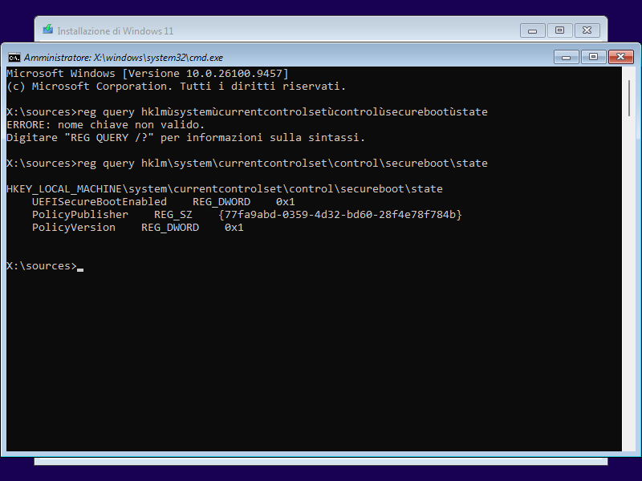
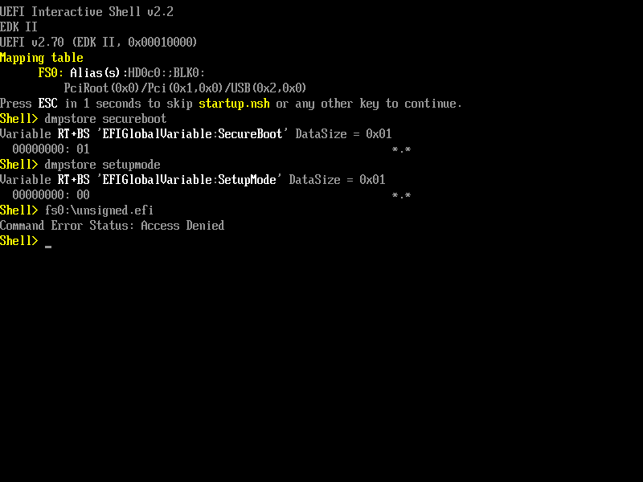
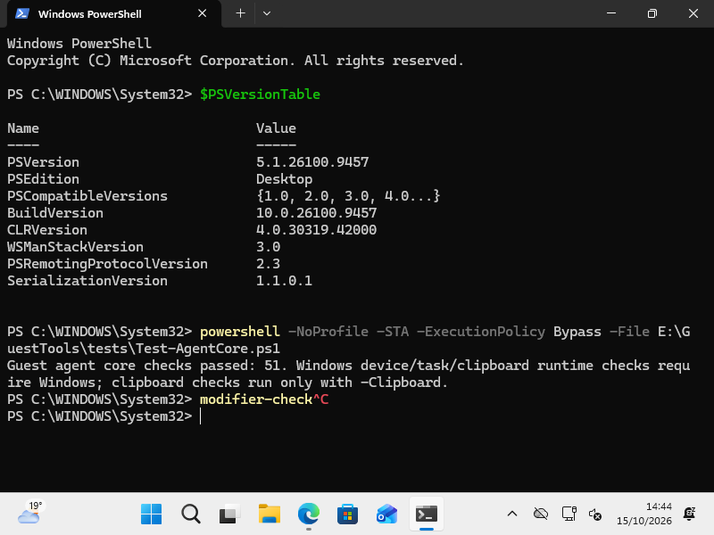

# Runtime verification ledger

Development host: Apple M4, 24 GiB RAM, macOS 27.2. Checks below were performed on 2026-10-15–16. This is a development record, not a claim of feature parity with Parallels Desktop.

## Native application and engine

- Optimized Swift 6 application built targeting macOS 14. The app bundle was signed ad hoc and passed `codesign --verify --deep --strict`.
- QEMU, qemu-img, swtpm and 23 private runtime libraries were bundled. Inspection found no non-system absolute dylib dependencies. Executables run from the generated bundle, and engine discovery selects its bundled paths.
- The complete bundle was installed under the user's Applications directory and passed deep/strict signature verification there. The baseline Windows VM ran with the installed bundled engine and QEMU; all discovered runtime, firmware and driver paths resolved inside that moved app. The graphics clone first used a private experimental QEMU; the 2026-10-16 checkpoint below uses the normal installed QEMU 11.1.2 bundle.
- Creation through the actual native app selected the supplied ARM64 ISO and created a stopped VM with 4 CPUs, 8 GiB RAM and an 80 GiB sparse disk. The library displayed the result.
- Rust unit/integration tests, native console/client/window tests and lint checks run with `scripts/check.sh`. The initial console cancellation fixture had a handshake/request race; its fix passed ten consecutive complete console runs.
- Independent raw import and stopped clone were checked with real qemu-img: source bytes preserved, no backing-file dependencies, source unchanged, clone still valid after the disposable source was removed.
- QCOW2/raw export was checked with real qemu-img for bytes, capacity, no backing chains and independence after removing the disposable source. The source was unchanged; existing destinations, dangling symlinks and publication races are refused. Cancellation tests verify that the exact conversion child is reaped and staging is cleaned. The actual native model also exported a stopped, empty private fixture and verified its returned artifact. A separate test app using the real optimized GUI then completed the menu → native save panel → owned test folder → Disk Exported flow; qemu-img independently confirmed the exported disk's contents match the source.

## Windows runtime

A separate private VM uses 4 CPUs, 8 GiB RAM, a 64 GiB qcow2 disk and the user-supplied Windows ARM64 ISO. Windows PE reports version 10.0.26100.9457. The guest reached the Italian Windows 11 installation language screen.

The successful combination is QEMU/HVF, the upstream EDK2 ArmVirt build with RAMFB, explicit USB-BOT/SCSI CD-ROMs, NVMe, USB input and swtpm. Windows 11 Pro completed installation and initial configuration, then reached its Italian desktop. At the network page, the signed NetKVM Windows 11 ARM64 driver was selected from the sanitized driver disc; Windows displayed **Rete — Connessa**. The installed desktop opened Windows PowerShell and executed `whoami` successfully. Optional updates were deferred through the official setup link and still require completion.

The native app's Shut Down action stopped that Windows session normally; all three owned runtime processes exited and `qemu-img check` reported no image errors. While stopped, the disk, EFI code/variables and TPM persistent state were cloned into the app's normal private library. SHA-256 comparisons confirmed exact preservation, including UUID and MAC. The original test copy remains retained. The installed app, launched without a development data-directory override, discovered **Windows 11 Pro** and booted it back to the desktop with the installation ISO ejected. The restart adds the integration serial port and output-only audio, and selects QEMU's Italian keyboard map. Device presence is not yet an end-to-end driver/audio result.

Windows PE's own registry reports:

```text
HKLM\SYSTEM\CurrentControlSet\Control\SecureBoot\State
UEFISecureBootEnabled    REG_DWORD    0x1
```

This was observed after booting the independently built secure firmware. Its code SHA-256 is `5604f775025d25829fd0313acea2d2aa30ff4e3befc6da2eae1e522efc9ea429`. The compatible enrolled variable template contains active PK, KEK, db and public Microsoft 2011/2023 trust certificates. QMP reports an active emulated TPM TIS device; Windows TPM provisioning/health still needs verification after installation.

On the installed baseline desktop, `Confirm-SecureBootUEFI` subsequently returned `True`. `Get-Tpm` failed with `TpmWmiException` / `0x80284001` before changing the graphics backend, so healthy Windows TPM provisioning is not established. `manage-bde -status C:` reported used-space encryption at 100%, XTS-AES 128, an unlocked volume, protection off and no protectors; no encryption or TPM setting was changed. A later boot completed the visible Windows update stage and returned to the desktop, without establishing that all updates are installed.



## Display and input

The initial native `VMConsoleView` received an 800×600 framebuffer. Its raw RGB bytes matched an independent QMP export exactly: **0 differences across 1,440,000 bytes**. The native app displayed the live Windows installer. Guest keyboard input through QMP was used for firmware and Windows PE diagnostics; later desktop checks are recorded below.

On the installed Windows desktop, native pointer actions opened Explorer and PowerShell. The Italian QEMU map correctly entered a Windows path, backslashes, colon, hyphens and a PowerShell `$` variable. A real Control-C attempt initially appended `c`; after modifier reconciliation was implemented and the app rebuilt/reinstalled, the same native input cancelled `modifier-check`, displayed `^C` and returned to a fresh prompt. Eleven causal native-event/wire regressions fail on the old implementation and pass with the correction. This is a concrete shortcut check, not evidence for every keyboard combination or dynamic guest resolution.

An isolated 60-frame, 1920×1080 raw transport benchmark measured a five-run median improvement from 0.612 to 0.505 seconds after contiguous full-width reads. This measures decoder transport, not Windows rendering frame rate or GPU acceleration.

Actual fullscreen testing exposed a race where a retiring SwiftUI accessor could clear its replacement's native window. A causal regression check fails with the old implementation and passes with the repair. The real bundled SwiftUI integration check passed, and the installed app was independently exercised through both native Enter Full Screen and Exit Full Screen transitions: sidebar/controls disappear and return, and AppKit style bits agree with the UI model.

The installed application now presents immutable RFB frames through Metal, with one GPU submission and one replaceable pending frame. Actual live diagnostics confirmed a completed Metal frame from the Windows clone (`source=rfb`, 640×480 into a 3280×1474 drawable, no Core Graphics fallback). Offscreen GPU checks cover colors, orientation, opacity, fractional/integer scaling and lifecycle changes. This accelerates presentation on the Mac; it does not establish accelerated Windows rendering or a Windows frame-rate improvement.

The automatic-sizing controller serializes bounded RFB size hints and Guest Tools requests. It reports success only after both the guest's measured mode and actual received framebuffer pixels agree. Its initial thirteen native/CLI/RFB fixtures covered rapid window changes, Retina scale, stale connections, missing acknowledgements, unsupported displays and false success replies. After the guest-channel permission correction and restart, actual `guest-display-status` reported `connected=true`, `can_resize=true`, the expected VirtIO DOD adapter and a measured 1920×1200 mode. The subsequent normal-runtime window/fullscreen acceptance and expanded 41-fixture checkpoint are recorded below.

The updated console passed 38 native fixtures, including bounded input queues, real recorded AppKit events, text-symbol normalization, background pacing and a numeric-only opt-in diagnostic. It was built, signed, installed and reconnected to the running clone without stopping Windows. Live diagnostics confirmed Metal presenting its 1920×1200 framebuffer without fallback. Slow native input then printed `/ * { } [ ] @ # 5"` exactly in Windows PowerShell. Command+R opened Windows Run without the old repeated `r`, and Escape returned to PowerShell. Fast input still lost characters or key releases at that checkpoint. A controlled 11-character burst recorded all 11 native down/up events, all 13 normalized down/up events accepted and written, and 10.198–11.126 ms wire gaps. Enabling only QEMU's argument-free `hid_kbd_queue_full` tracepoint recorded ten actual HID overflows; Windows showed a stuck `H`. Slow explicit releases and Control+C recovered the prompt, and the tracepoint was disabled again. This localized the loss after the native writer; its finite-VNC-queue timing fixture did not model the actual HID overflow. The later QEMU 11 fix and bounded Windows regression are recorded below.

A separate QEMU backpressure patch now waits for both the delayed input queue
and active USB HID FIFO before consuming each complete RFB key message. Its
fresh full build rebuilt all configured consumers of the modified VNC header.
Root independently passed the extracted-production C ASan/UBSan checks, real
linked parser/socket/event-loop suite and probe-free binary smoke. With polling
suspended, all 26 fixture transitions survive, framebuffer jobs still progress
and ingress does not busy-spin. The real tests also cover two-client disconnect
ownership, fragmented extended/E0/E1 input and safe console switch/rebind.
Bypassing only HID readiness reproduces exactly ten actual FIFO drops. The
final separate binary has no QA probe and has the Hypervisor entitlement. A
byte-identical private candidate passes strict signature verification after a
byte-only copy avoids the build output's empty Finder/resource-fork metadata.
That separate QEMU 10 candidate was not installed in the Windows VM. Its QEMU
11 adaptation is included in the later normal-runtime checkpoint below;
qtest alone does not establish Windows USB scheduling or HVF input reliability.
[Frozen patch, full reproduction and limits](../experimental/input-backpressure/README.md).

### Earlier isolated Windows graphics clone

With the baseline shut down cleanly, an independent 64 GiB qcow2 clone was created without a backing file. Its EFI variables and TPM files are independent copies, not writable shared state; copied TPM contents still represent the same initial cryptographic identity. The baseline image passed `qemu-img check` without repair and remains stopped.

The clone initially booted through an identity- and file-bound private launch wrapper using the pinned QEMU 10 fork and hybrid `virtio-ramfb` device. QMP confirmed the display at PCI slot 7, the original USB/network/storage/serial/audio slots preserved and the TPM emulator retained. Windows reached its desktop. Windows verified the official Windows 11 ARM64 `viogpudo.cat` as `Valid`, signed by Microsoft Windows Hardware Compatibility Publisher. `pnputil` installed only that package as `oem4.inf` on `VEN_1AF4&DEV_1050`; CIM then reported **Red Hat VirtIO GPU DOD controller**, status `OK`, device error code `0`, version `22.7.38.43` and **1024×768**. The actual Win32 display module subsequently enumerated safe modes and applied **1920×1080** and **1920×1200** through `CDS_TEST` followed by an active-mode change. Each operation returned `applied=true`, `changed=true`, the measured requested dimensions and the expected adapter; the installed native console visibly received the changed display. A 1280×720 request was rejected as not exposed by this driver, preserving the previous mode. A subsequent full Windows restart returned to the desktop, and the live display module still identified the expected adapter with resize support and 1920×1200 current mode. Root also observed `Confirm-SecureBootUEFI=True` after the DOD installation and mode changes. This is a display-only driver, not hardware 3D acceleration.

### Normal installed adaptive 2D runtime — 2026-10-16

The same graphics clone subsequently started from the normal installed app and
owned engine supervisor, using the saved `display_adapter=virtio-ramfb` profile.
The private QEMU 10 launch wrapper is no longer used by this path. The retained
QMP receipt reports **QEMU 11.1.2**, a running guest, modern VirtIO display
`1af4:1050` at PCI slot **7**, unchanged USB/network/RNG/NVMe/serial/HDA slots
1–6, and the emulated TPM TIS still present. The production overlay contains
only hybrid firmware-RAMFB/software-VirtIO-2D and HID-backpressure patches;
OpenGL, VirGL, Rutabaga and Neptune are disabled. The normal firmware source
is unchanged.

Actual Windows and native-console acceptance on that installed runtime found:

| Check | Observed result | Retained evidence |
| --- | --- | --- |
| Normal start and hardware layout | Windows desktop; QEMU 11.1.2, display slot 7 and TPM retained | `windows-adaptive-runtime-qmp.json` |
| Driver health | Red Hat VirtIO GPU DOD **22.7.38.43**, `ConfigManagerErrorCode=0`; Windows measurement **1512×982** | Root's actual Windows screenshot observation; not inferred from the driver package or display-status schema |
| Fast native text | One native `typeText` call produced **78 exact characters**, without clipboard or pacing workaround; **0 new HID overflow events** (counter 10 → 10); tracing disabled afterward | `windows-adaptive-hid-burst.json` |
| Symbols and selection | Root observed 41 exact symbols/path characters plus newline after that burst, 120 total; Control+A selected 120/120 | `adaptive-runtime-root-validation.json` |
| Native fullscreen | Guest Tools measured **3024×1964**, connected and resize-capable | `windows-adaptive-fullscreen-display.json` |
| Return and smaller window | Native fitted state **1920×1200**, then **1512×982**; the latter also independently measured by Guest Tools | Aggregate validation and `windows-adaptive-small-window-display.json` |

These are working 2D window/fullscreen and input checkpoints on one Windows
guest. The two display-status receipts report `dpi_change_supported=false`
and `dpi=null`; no Windows scaling/DPI change is established. No sustained
frame rate, 60 FPS, Windows hardware 3D, DWM/Present correspondence or complete
keyboard/layout coverage was measured. The isolated Neptune/DXMT work below
remains experimental and is not part of this installed runtime.

Root independently repeated the real fw_cfg → VirtIO 2D → RFB251 tests, input
tests and ten-drop negative control, ASan/UBSan cleanup/identity negative,
probe-free smoke, source/signature checks and ten packaging unit tests. The
frozen build [provenance](../experimental/runtime-display/provenance.json)
identifies the pre-relocation executable as
`36ccc78a264ce650af2649e3ab8feea2bae30a08d869791fd5221ad1c11dbe22`.
The installed runtime manifest and a read-only byte hash both identify the
relocated/signed executable as
`90b9c248a613cdcd1ac8b35b41d63b565dac541bb0e402bb64733092eff20caa`.
The build provenance's `Windows_guest_acceptance=NOT RUN` records its earlier
build-only freeze; the later Windows results above are retained separately.

The expanded display-sizing integration log passes **41 fixtures**, including
bounded startup retries, exhaustion, deadline, hidden view, terminal error and
cancellation. Source inspection confirms serialized retries only for agent
timeout/unavailable, with 2/5/10/20-second delays inside a 60-second startup
budget. This is fixture evidence, not a live startup result. The aggregate
receipt initially recorded that GUI as staged; root subsequently installed the
final bootstrap GUI, including the console-during-stopping correction, and
reported successful deep/strict signature verification. The installed QEMU
bytes remain identical. **A fresh Windows startup with the bootstrap GUI is
still unverified**; the running session's earlier resize checks do not prove it.

The following ignored receipts/logs were read without contacting a VM. Full
payloads remain private because some contain VM identities and local paths;
these SHA-256 values bind the summarized evidence at this checkpoint:

| Artifact under `.tools/` | SHA-256 |
| --- | --- |
| `windows-adaptive-runtime-qmp.json` | `cf370ce1cf65be7a3c4089d9768dcbb8f905854b3439b26c46ba42a5478f530c` |
| `windows-adaptive-hid-burst.json` | `fd72dcc7c27a91de7ae1bf302be35a5915230a8c6c8b342f07609ed6fd67ab6c` |
| `windows-adaptive-fullscreen-display.json` | `ac27ed4ab65c9a9f8cc316e15eb265c7c8dd7594bd6f7d8aee20dbf8b5c8ebb8` |
| `windows-adaptive-small-window-display.json` | `55c86f4f09f98766bcd96e956b345ac74bfa1ad62608c07672ee58357cbc6ead` |
| `adaptive-runtime-root-validation.json` | `b28dafa2157fcd5cb2fccdf5444b2cecf0e484a34650c504677a79d1a8d95aa6` |
| `display-bootstrap-root-final.log` | `0870ed0ff73d0e93dd0290e3a77610d091a9612c01e10b027f7df7c708df5f26` |
| `build-adaptive-bootstrap-root.log` | `6aa7e6bd6eecc718ce2cc5087a2f3f83340eb43d86345ff9e38e0bce1f99fb58` |
| `build-adaptive-shutdown-console.log` | `6b73668525f05fab56a278006b222b6ee5959c7ddca8e1cde33d8fc39cbaa8bf` |

### Separate 3D experiments

The host-only Neptune/DXMT snapshot pipeline independently passed 8 frames and 7,042,042 exact VNC pixels, including 1920×1080 and resizing. Root repeated the actual pipeline successfully. Missing readiness produced no pixel read; ownership/ACK/disconnect guards and a causal broken-reader check also passed. A subsequent real-worker broker check passed three frames and 1,889,021 exact VNC pixels across worker restarts, resource invalidation and readiness/ACK failures; root repeated that check too. [Snapshot reproduction and limits](../experimental/neptune-snapshot/README.md), [real-worker broker checks](../experimental/neptune-broker/README.md).

The next isolated overlay now exercises the real QEMU virtio control queue, Neptune proxy, server, spawned worker, asynchronous decoder ring and actual scanout selection. Root rebuilt and reran all five real-path checks and both required failing mutants successfully with `scripts/graphics-live.py --causality`. Baseline and reset/recreation each compare four frames / 1,920,000 exact VNC pixels; baseline also verifies all 3,840,000 original pixels were overwritten before immutable-snapshot consumption. Withheld readiness produces no read/submission/readback allocation; a reused fence value produces no new snapshot; an old post-ACK continuation cannot retire a newer same-ID lease after reset. Readiness and exact-resource mutations fail for their intended causes. This proves the bounded host resource/snapshot path, not a one-to-one Windows Present association, ARM guest memory ordering, DWM composition, sustained fluidity or Windows 3D acceleration. It uses separate diskless, stopped-CPU fixtures and is not installed in the app or Windows VM. [Actual path, reproduction and explicit limits](../experimental/neptune-live/README.md). Static Parallels graphics evidence is recorded separately in [the REA findings](PARALLELS_GRAPHICS_REA.md).

## Independent certificate enrollment

The new offline enrollment path starts with the source-built empty ArmVirt store, creates a local RSA-3072 platform certificate and enrolls it with pinned `virt-firmware 26.10`. The database includes Microsoft Windows Production PCA 2011 and Windows UEFI CA 2023; KEK includes the local public certificate and Microsoft KEK 2011/2023. The private key stays in the ignored build area with mode 0600 and is never packaged. No installed UTM variable template is needed by this path.

An isolated QEMU/HVF firmware VM, separate from the ongoing Windows installation, reported `SecureBoot=01` and `SetupMode=00`. The supplied Windows ISO's signed ARM64 boot loader was accepted and reached its own “Press any key to boot from CD or DVD” prompt. An unsigned ARM64 Shell.efi built from the same EDK2 sources was refused with `Command Error Status: Access Denied`. This checks firmware enforcement, not Windows desktop provisioning or current revocations. That initial template used virt-firmware's placeholder DBX.

A separate negative-control store with SecureBootEnable disabled executed that exact unsigned file and started a second shell, while reporting `SecureBoot=00`. That control was confined to the disposable firmware VM; the Windows installation retained Secure Boot throughout. Both firmware test processes were stopped after capture.



A subsequent, separately generated factory template contains 26 pinned Microsoft ARM64 image hashes. In disposable firmware VMs, the current Windows loader was accepted; a benign signed EFI canary executed, and the exact same file was rejected after adding only its Authenticode hash to DBX. Host verification of Microsoft's 22-entry signed subset also passed. Firmware rejected the original signed runtime update with `EFI_SECURITY_VIOLATION`, so runtime update/migration remains unverified. The current installed Windows VM and application template have not been changed by these tests. [Exact scope, reproducible tests and remaining limits](SECURE_BOOT_DBX.md).

## Guest integration checks

The Rust guest transport, native explicit clipboard/file controller and independent Windows PowerShell agent pass the normal checks. The native harness uses a recording clipboard and proves that readiness never accesses clipboard contents, failed reads preserve existing text, private clipboard payloads are cleaned up, capabilities gate operations and partial transfers do not count as success. The PowerShell core passed 51 checks in the verified official PowerShell 7.6.7 runtime on macOS, including a full 1 MiB file and strict framing/encoding/path validation. The same 51 checks subsequently passed inside the actual Windows guest with native Windows PowerShell **5.1.26100.9457**, Desktop edition, launched with STA and a process-only execution-policy option. This verifies the Windows protocol/file code; device opening, scheduled-task installation and live clipboard remain separate acceptance checks.



The Windows GUI installer subsequently accepted the signed ARM64 network and serial packages. Network return code 259 was accepted only after binding the healthy, signed, present device to the exact installed INF bytes; serial installation returned 0. After a full Windows restart, CIM reported `VirtioSerial`, the network adapter and High Definition Audio with device error code 0. This proves enumeration and driver health, not working sound. The user tools and their scheduled activity were present, but opening the fixed serial port initially returned **Win32 error 5 (access denied)**. The strict task predicate also rejected Windows' unqualified principal spelling. Canonical OS SID resolution now proves the exact owner, without a textual name fallback; all ten ownership clauses subsequently passed in actual Windows. The installer and uninstaller reuse those reviewed declarations, preserve the existing action/description checks and support upgrading an owned older manifest. Their 118 portable checks include a causal legacy-name regression.

The explicit per-port access helper passes 471 portable checks and the diagnostic passes 308; these compile the real C# while using synthetic descriptors and devnodes. The initial 75 synthetic checks also passed under actual Windows PowerShell 5.1. Actual inspection with the 355-check version identified a unique fixed alias, exact hardware/instance, healthy direct VirtIO serial PCI parent and raw-device capability. The raw PDO is classless: unified class retrieval returned `ERROR_NOT_FOUND` (1168), the legacy property returned invalid-data (13), and both probe values were empty. The validator accepts only that exact observed combination plus the other identity guards; it does not treat arbitrary lookup failures as a match.

With the user's explicit action-time approval for the isolated clone, the helper saved a protected rollback receipt, added only that desktop owner's read/write ACE to this per-instance security property and verified readback. No global class ACL or agent privilege was changed. `RuntimeAccessVerified=False` described the helper's pre-restart result, not a completed runtime check. The updated agent was then installed for the same desktop account with its limited interactive task. After a full Windows restart, the actual native Guest Tools tab reported **Guest Tools connected / Perpendicular Guest Tools 0.2.0**, and the installed engine independently received a valid live display-status response. The later normal-runtime checkpoint above verifies actual window/fullscreen fitting. Clipboard/file action availability is observed; successful content transfer remains unverified. [Exact scope, rollback and invocation limits](GUEST_CHANNEL_ACCESS.md).

The successful Apply used an already elevated, same-account fresh Windows
PowerShell 5.1 process and its normal confirmation prompt. A separate invocation
defect in the automatic UAC-child path (`-File -Confirm:$false` Boolean binding)
has since been corrected in source using bounded UTF-16LE `-EncodedCommand`
and one exact single-quoted script literal. Parent confirmation, UAC, readonly
package and all ownership/device guards remain. Root repeated the expanded
471-check suite, including an actual harmless noninteractive PowerShell child
which binds the Boolean and preserves failure status. This tests payload
construction and execution on macOS; real Windows UAC elevation with that new
path remains unverified. The approved ACL Apply must not be repeated.

The new independent display module passed 30 fixture checks under actual Windows PowerShell 5.1, including compilation of its native declarations. Those fixtures do not call display APIs or change a mode; the separate live clone checks above establish actual enumeration/application.

The display view now ignores unsolicited RFB ServerCutText messages. Only the explicit Guest Tools actions can replace the Mac clipboard with guest text. The console protocol, native drawing/input and explicit Guest Tools controller checks passed again with the full Xcode toolchain; this does not replace live Windows clipboard validation.

The driver disc also includes an explicit Windows GUI installer. It separates the elevated, fixed signed-driver helper from the original desktop user's limited agent installation. Its 54 portable checks pass, and the current disc includes the revised diagnostics/access helper. Actual Windows Forms, signed driver installation, same-account agent upgrade and post-restart connection have now been exercised as described above; other installer branches remain fixture-only.

The complete normal check with the optional real Metal and PowerShell suites passed on the 355-check helper version: Rust engine/CLI, 38 native console checks, display-sizing integration, guest agent core/display/installer/ownership/diagnostic/access checks and offscreen Metal correctness. The subsequent UAC-payload-only correction passed the targeted 471-check helper suite independently. Synthetic GPU timings are not Windows frame-rate measurements. Saved keyboard layout and output-audio configuration have engine/native tests; actual Windows sound remains unverified.

## Diagnosed compatibility failures

1. The UTM variable template is QCOW2 despite its `.fd` name. Decoding it to a 64 MiB raw flash bank fixed the flash-size failure. Existing offline malformed templates are repaired with a backup.
2. QEMU 11's TPM PPI creates a sub-page RAM region rejected by HVF on a Mac with 16 KiB pages. `ppi=off` avoids that region while retaining TPM2. This removes firmware-mediated physical-presence operations such as Clear-Tpm. See [the upstream QEMU report](https://gitlab.com/qemu-project/qemu/-/work_items/4587) and [Lima's workaround](https://github.com/lima-vm/lima/pull/5544).
3. VirtIO GPU's firmware GOP uses PixelBltOnly. The observed Windows CD boot path attempted direct framebuffer access and entered its exception loop. Building ArmVirt with the RAMFB driver provides a nonzero linear framebuffer and permits Windows boot. Sources: [RAMFB implementation](https://github.com/tianocore/edk2/blob/master/OvmfPkg/QemuRamfbDxe/QemuRamfb.c), [VirtIO GOP implementation](https://github.com/tianocore/edk2/blob/master/OvmfPkg/VirtioGpuDxe/Gop.c). REA caller analysis evidence: `ev_2569ca74c5f6df16eece2aba9a066e65f88ca21353508878f99fbaee8aa15fa3`. Exact intermediate register/memory observations remain local; this is an observed compatibility diagnosis, not a universal claim about every Windows release.
4. A generic USB storage frontend over a pure block node presented the ISO as a removable RAW disk to Windows PE. Explicit USB-BOT plus `scsi-cd` changed it to optical media and removed the missing-media-driver screen.

## Remaining required work

Verify Windows TPM health and desktop networking; finish deferred Windows updates; audio; clipboard, shared folders/transfers and USB integration; fresh-start Guest Tools bootstrap, broader resize/input endurance and Windows graphics acceleration; actual Windows snapshot recovery; current DBX revocation provisioning and release packaging. The bounded adaptive-2D/fullscreen and fast-keyboard checks above are complete, without establishing all driver/mode/layout combinations or sustained fluidity. The authoritative feature checklist remains [FEATURES.md](FEATURES.md).

## Local cursor integration — 2026-10-16

The checkout now negotiates the standard RFB Cursor pseudo-encoding and
presents its image/hotspot with AppKit cursor rectangles, independently of
framebuffer arrival. This closes the earlier decoder-only implementation gap.
The socket fixtures verify separate cursor-only delivery, shape/header bounds,
mask/alpha bytes, hide, hotspot-vs-framebuffer semantics and following raw frames.
The AppKit fixture checks real cursor image geometry, a bounded latest-value
relay, focus/status guards and cleanup without system pointer injection.
[Contract and acceptance limits](../macos/Tests/RFBCursor.md).

The `.tools` experiment builds, installed app and old ignored research
receipts referenced by earlier checkpoints were not present when this work
resumed. The historical performance and runtime checkpoints above do not
qualify this new client on this machine. The user subsequently identified the
existing Parallels Windows VM as the available source and authorized its use.
Windows completed a normal shutdown; an independent APFS clone of its single
base HDS was created with the source stopped and fully hash-compared against
the original (18,536,726,528 bytes). Its receipt and descriptor remain private
under `.tools/vm-migration/`. The original VM remains registered and stopped.
The pinned QEMU 11.1.2 runtime and secure firmware were rebuilt and bundled in
the normal installed application, which passed strict/deep signature checks.
This is the baseline 2D runtime, not the experimental 3D runtime. Conversion
to compressed QCOW2 passed integrity checking and virtual disk comparisons
both before and after import. Both comparisons reported identical images.
The generated conversion intermediate was removed after verification; the
original VM, read-only source snapshot and final imported disk remain intact.

Starting the imported VM through the installed application's GUI reached
Windows, which crashed and entered WinRE. Its startup repair log reported zero
root causes, and no Minidump directory was found. The offline SYSTEM hive had
Current/Default control set 1, stornvme Start 0, but StartOverride value 0 was 3.
After successfully saving the complete hive inside the imported guest as
`C:\Perpendicular'before'nvme'SYSTEM.hiv`, only that override was changed to
DWORD 0. Readback and hive unload succeeded. A subsequent reboot entered the
automatic diagnostic path again. Choosing Continue then produced a visible
`KERNEL_SECURITY_CHECK_FAILURE (0x139)` stop screen; desktop startup still fails.
The NVMe change alone does not resolve this separate kernel failure, whose
responsible module and bugcheck parameters remain unknown. This intervention affects only
the imported copy. Microsoft's [controller migration guidance](https://learn.microsoft.com/en-us/troubleshoot/azure/virtual-machines/windows/troubleshoot-nvme-boot-failure)
explains the boot-driver requirement; the local registry readings justify the
specific intervention without establishing the crash cause conclusively.

Xcode 27.1 finished installing from Apple's App Store. Its first launch requires
acceptance of the Xcode and Apple SDKs Agreement; explicit user confirmation
has been requested and remains pending. Metal builds have not used this new
toolchain yet.
Required next gates include successful desktop startup, real cursor shape/hide
and native scanout composition, and measuring input-to-image latency before/after. A passed
socket/AppKit check is not a Windows smoothness or 3D integration result.

The complete default `scripts/check.sh` passes on this checkout after the cursor
integration: Rust formatting/lints/unit/CLI checks; decoder oracle plus its
required failing bit-order mutant; the complete socket/AppKit console suite;
all display-sizing fixtures; native client/window/guest-tools/export checks;
and Python source/provenance tests. Three Rust checks requiring real external
runtime/tools are explicitly ignored by default. Optional PowerShell/Metal
lanes were not enabled in that command. The native-display build configuration
also type-checks with the actual C transport header. The raw-frame mock benchmark
still completes all five 60-frame 1920×1080 runs after cursor negotiation changed;
these are host socket-throughput checks, not Windows FPS/latency measurements.

Two existing test timing races were repaired: the export converter now publishes
its mock readiness PID by atomic rename, and the input diagnostics fixture stays
alive through its idle flush even when an unordered window has no run-loop
sources. The compressed absolute-bootstrap-deadline fixture now allows two
seconds for its two real Python subprocesses to reach the held-response gate;
it still requires expiry and rejects the late result. Production startup and
resize timeouts were not increased by these fixture changes.

### Control availability and migration follow-up — 2026-10-16

The pinned graphics source fetch and independent verification completed,
including the LLVM 15 static/header bottle, required QEMU wraps and private
PyYAML package. All eight fetch/provenance fixture tests pass. These outputs
remain private under `.tools/graphics-experiment`; they are not a built or
installed 3D runtime.

A second WinRE inspection found neither MEMORY.DMP nor Minidump. It confirmed
that `prl_strg` (Parallels paravirt disk filter) and `prl_tg` (Parallels Tool
Device) are boot-start drivers. The disk class LowerFilters contains exactly
`prl_strg` and `EhStorClass`. The complete SYSTEM hive was saved successfully
as `C:\PerpendicularCrashBackup.hiv`. No Parallels service/filter or CrashControl
value has been changed. A guarded repair script was prepared on a read-only
diagnostic ISO but has **not been executed**. The attempt to insert that ISO
from the Desktop workspace left QEMU blocked in `open()`: a native process
sample and macOS TCC logs identify a pending DesktopFolder access prompt for
the installed app. The owned QEMU process remains alive; no duplicate launch
or forced termination was attempted. User dismissal was requested so the ISO
can instead be staged under the app's data directory.

That observation exposed a separate status bug: the engine classified an
unreachable QMP endpoint as a crash even when process termination was unproven.
It now returns `unavailable` in that branch. The client labels it Control
unavailable, offers no Start action, and retains stopped-only configuration and
clone guards. No native display endpoint is exposed without successful QMP
identity/status verification. Eight native-display/lifecycle Rust tests,
all-target Clippy, and the standalone engine client check pass. The complete
Swift UI sources compile with the existing Command Line Tools SDK. This change
is not yet installed into the running app. A default full Rust run and the
DiskExport UI fixture cannot pass while their absolute `/usr/bin/python3`
launcher is blocked by Xcode's pending license; their failures do not establish
a lifecycle regression. No full-suite success is claimed for this checkpoint.

REA accepted the installed ARM64 `prl_tg.sys` target (SHA-256
`92139c536400a65ccd710c55b926769bee1c29ae86f3546f1fd396aa52a0f520`),
but Ghidra startup failed because REA's macOS process-ownership helper invokes
`xcrun swiftc`, now gated by the same pending Xcode agreement. The exact launch
error is retained privately. No driver decompilation or attribution of the
Windows crash to that driver is claimed. This artifact has not been matched
to the driver's bytes inside the imported guest.

A separate release candidate is now built at
`.build/candidates/control-unavailable/Perpendicular Desktop.app`, from local
commit `1af7b35`, using the existing Command Line Tools compiler and SDK.
The engine release and Swift app with native-display transport compiled
successfully. The candidate passes deep, strict code-signature verification;
its engine responds to `--version`. All 185 copied resource files other than
the rebuilt engine match the installed app by SHA-256. This is a candidate
build check, not a Windows boot or 3D test. It has not replaced or launched
alongside the installed app: the existing guest process is still alive with
its control endpoint unavailable, pending dismissal of the Desktop access
request. The new Xcode agreement remains pending; no acceptance is implied
by using the previously available Command Line Tools.

The REA CLI blocker was subsequently resolved without accepting the pending
Xcode agreement or changing persistent MCP configuration. REA 6.5.0 supports
`REA_DARWIN_SWIFTC_PATH` and `SDKROOT` for its macOS process-ownership helper.
Selecting `/Library/Developer/CommandLineTools/usr/bin/swiftc` and
`/Library/Developer/CommandLineTools/SDKs/MacOSX.sdk`, together with the existing
Ghidra/Java installations, completed Ghidra default analysis of the same
`prl_tg.sys`. A `DriverEntry` name search returned no matches; the PE header
instead identifies entry address `0x140009088`. An address-based function
query recovered its 56-byte body, assembly, pseudocode and two direct callees
(`0x1400090c0` and `0x140009000`), with a normal return. Evidence IDs are
`ev_adcb3168a871387dfd1c01336c86f5eb9887b2212f1d9f273d077e181e6b34d5`
and `ev_e97a6195c7e3425f5b96d5df7139c0d878d9fc4300d1badea0c799931f24df4d`.
Assembly preserves both incoming argument registers across the calls, while
the inferred pseudocode signature only declares one: inferred signatures are
not a recovered Windows driver ABI. The PDB is not loaded and original names
remain unknown. This establishes a working CLI analysis route, not a cause for
the guest's 0x139 failure. Complete evidence remains in ignored private storage.

The diagnostic ISO is also staged read-only under the app's Application Support
`Diagnostics` directory, outside Desktop, with a SHA-256 match to the prepared
921,600-byte image. It is not attached: the earlier pending QMP operation must
resolve first. No additional guest repair has been executed.


### Imported Windows desktop recovered — 2026-10-16

This checkpoint supersedes the pending control/ISO and candidate-install
status above. The owned process recovered QMP access without a duplicate
launch. The storage-filter experiment alone still produced bugcheck 0x139.
Bounded held-kernel captures analyzed with REA/Ghidra located the exception
address in `prl_fs.sys` (Parallels Shared Folders), without establishing the
origin of corruption. Complete observations, evidence IDs, inference limits
and backup details are in [Windows migration diagnostics](WINDOWS_MIGRATION_DIAGNOSTICS.md).

After preserving that evidence and stopping the already bugchecked process,
the locally verified control-availability candidate replaced the installed
app. The previous app bundle was retained; deep strict signature verification
passed. The normal app launched the existing imported VM with its 2D runtime.
A guarded WinRE repair backed up the SYSTEM hive and service key, then changed
only `prl_fs.Start` from 1 to 4 in this step. Windows subsequently reached its
desktop; a pointer click opened Start and typed text appeared correctly in
Windows Search. This is one successful desktop boot with basic input, not
a 3D, latency or long-term stability result. The original VM is preserved.
The pending Xcode agreement was not accepted. Work and commits remain local
at the user's request; no GitHub authentication or push was attempted.


### Escape routing and imported-guest setup — 2026-10-16

Two live Control-Escape attempts in the focused Windows console exited native
macOS full screen before the fix. The console's local event monitor now routes
Escape key-down to the guest before AppKit consumes it, with the same active
view, owning-window and first-responder guards as input release. Key-up still
uses the existing deduplicated release path. Other windows and controls retain
their own Escape handling.

The complete native console suite passed with the existing Command Line Tools
compiler/SDK, including plain and Control-Escape wire-order/release fixtures,
other-window and lost-focus checks, text/modifier bursts, pointer barriers,
reconnect, cursor and drawing checks. Removing only the production Escape
change in a private harness caused the new plain-Escape fixture to fail before
guest delivery. Unknown test filters now fail instead of printing success
without executing a fixture; that negative case was also verified. This is a
console-suite result, not a new complete project/Metal performance check.

The full Swift UI and native transport compiled for macOS 14, and the candidate
passed deep strict signature verification. All 186 resource files match the
previous installed app. After a normal VM shutdown, the app was replaced and
the previous bundle retained. The same VM then reached its desktop from the
updated normal installed app. With console focus, Control-Escape visibly
opened Windows Start while native full screen remained active; plain Escape
closed Start and also retained full screen. Subsequent Control-Escape attempts
did not consistently reopen Start, although full screen remained active and
clicking the taskbar Start button worked. The repeat-input discrepancy remains
unresolved; this checkpoint does not establish keyboard endurance. With the
VM keyboard layout set to Italian, the literal punctuation sample
`a:b\c-_/[]@` was typed and echoed correctly in Windows PowerShell.
No latency or 3D improvement is inferred.

The driver provisioner now supports read-only native macOS image extraction,
verified source downloads and atomic cache publication. Real extraction, all
134 packaged-file hashes and cleanup after simulated failures were checked.
In the imported Windows installation, both signed VirtIO packages were
accepted and the exact limited-user agent task started. Its diagnostic
confirmed a healthy serial controller but fixed-port open failed with error 5.
Administrator Inspect produced the exact per-instance permission proposal;
Apply remains pending user confirmation. DNS/TCP connectivity to Microsoft's
port 443 succeeded. [Detailed scope and remaining limits](WINDOWS_MIGRATION_DIAGNOSTICS.md).

### Imported Guest Tools connected after approved access — 2026-10-16

The exact per-instance correction above was explicitly approved, reinspected,
applied and read back with a protected Windows rollback receipt. Following a
normal shutdown and Start from the installed app, the same VM reached its
desktop and its user agent answered two consecutive status requests: connected,
protocol 1, agent 0.2.0, ARM64, session 1. The display channel also answered,
reporting the actual fixed 800×600 Basic Display Driver and no alternative
safe mode. A small canary file transfer returned 53 bytes written in Downloads;
Windows PowerShell independently computed the same SHA-256 as the Mac source.
The normal app's Guest Tools tab visibly reported connected and version 0.2.0.
No clipboard contents were accessed. This supersedes the pending permission
status above; it does not establish adaptive display, 3D or long-term stability.
[Exact sequence and acceptance limits](WINDOWS_MIGRATION_DIAGNOSTICS.md#approved-per-device-access-and-connected-channel).


### Imported VM adaptive 2D restored with a fresh CLT build — 2026-10-16

This checkpoint concerns the imported 4-core/4-GiB VM above. The adaptive
runtime entries earlier in this ledger describe a previous installation; the
bundle present before this change lacked `virtio-ramfb`. The runtime builder
now respects the caller's developer tools instead of forcing full Xcode.
A fresh pinned QEMU 11.1.2 production build completed with Command Line Tools,
software 2D and the reviewed hybrid-display/HID patches. Its unsigned-source
selection and signed candidate are recorded in private provenance; candidate
SHA-256 is `ca9056b5036bb896c802b9f7e9bc4893ad31c5762fe7f76f1eed2d3493f0b8e1`.
The real diskless display test passed firmware RAMFB pixels, modern VirtIO at
slot 7, framebuffer handoff and a guest-applied RFB resize to 1280×800. The
probe-free production QMP/RFB/shutdown smoke passed, as did all ten runtime
bundling checks. The smoke harness refuses application-bundle paths by design;
its attempt against the packaged path was refused before launching a child.
The packaged executable separately advertised `virtio-ramfb` and the full
bundle passed deep strict signature verification.

Windows independently reported the official ARM64 DOD catalog signature as
`Valid`; staging only `viogpudo.inf` added `oem11.inf`. After normal shutdown
and closing the app, the checked runtime was installed with the previous app
and RAMFB profile retained for rollback. Main app and engine executable
contents, compared after removing signatures from temporary copies, are
unchanged. Only the stopped VM's display-adapter setting was changed.
The normal app's Start reached the Windows desktop; QMP confirmed the modern
1AF4:1050 display at slot 7. Guest Tools reconnected and Windows reported the
Red Hat VirtIO GPU DOD controller, resize support and 1920×1200. Entering native
full screen changed the measured guest mode to 2560×1600; returning changed
it back to 1920×1200, with the desktop visibly present in both states.
A display-channel request during transition was temporarily unavailable;
a later request succeeded. This is bounded 2D evidence, not a 3D, latency,
keyboard-endurance or sustained-stability result. Private state, hardware and
mode responses are retained in `.tools/vm-migration/adaptive-2d-current.json`.

A second normal shutdown and Start completed with a new engine launch identity.
The same user agent reconnected automatically, and the display channel again
reported the DOD adapter, `can_resize=true` and 1920×1200. No new device ACL
change was needed. The display name changed from DISPLAY2 to DISPLAY1 across
boot; no stable display ordinal is assumed. Driver PnP error code and version
were not independently queried in this checkpoint.


### Current-host native Metal publisher check — 2026-10-16

The unchanged two-process publisher fixture compiled and passed with the
existing Command Line Tools/SDK selection. Actual Metal work verified
1,927,421 pixels including rechecking immutable snapshots, bounded occupancy,
GPU-completion-before-publication and ACK retirement. The reconnect fixture
passed three connections with no additional guest updates, rejecting stale
GPU completions; nonzero-crop checks and both causal negative controls passed.
All retained captures and mappings were released at teardown. The private
receipt is `.build/checks/native-publisher/result.json`. This is host-only
component evidence: it does not exercise the Windows 3D producer, establish
its writer fence, measure presentation latency or change the installed 2D app.
The accompanying [REA transition analysis](PARALLELS_27_GRAPHICS_REA.md#virtual-transition-pending-render-state-drain)
adds static render-state and conditional-commit evidence, not runtime attribution.


### ACK-retired Metal backing cache — 2026-10-16

The independent publisher now caches at most two idle shared-memory/Metal
backings, in addition to its two active snapshot leases. Exact ACK, device,
dimensions and connection generation govern reuse; readiness pipes and frame
identities remain per-frame. Cache misses evict an idle mismatch so changed
geometry can enter the cache. Disconnect discards all unacknowledged storage
and the idle cache. There is still one GPU snapshot copy and no production
CPU pixel readback.

The expanded two-process Metal fixture passed 40 frames and 20,196,019 exact
pixel checks: retained-image immutability, two active leases, a GPU wait before
publication into reused storage, 32 repeated frames, a new geometry and return,
and an old unacknowledged mapping surviving a new connection's different image.
The first 35 frames used two backing allocations and 33 reuses; the same
fixture with only caching disabled allocated 35 and failed the reuse check.
The whole run used four backings, 36 reuses, 40 per-frame capture objects and
39 ACKs (one unacknowledged frame discarded on reset). All backings/captures
and mappings were released, with zero active or cached entries at shutdown.
Separate private mutants fail when idle-size eviction is removed or when an
unacknowledged backing is recycled after disconnect. Existing crop and
initial-refresh causal negatives also pass.

The actual native receiver and external-presenter suites passed, including a
real held GPU event, replacement, reset/stop and stale connection ACK isolation.
Pure Cocoa patch-anchor/escaping/protected-input fixtures passed against the
pinned pristine source; no full archived QEMU build-input gate or new QEMU
build is claimed. Results remain under `.build/checks/native-publisher/` and
`publisher-pool-{receiver,presenter}.log`. This is allocation/lifetime evidence,
not Windows presentation FPS, latency, 3D integration or an installed-app result.


### Metal compiler component restored — 2026-10-16

The read-only full-Xcode first-launch check now exits 0 (Xcode 27.1,
27A9275), superseding the earlier pending-license blocker in this ledger.
No license-acceptance or first-launch setup command was run in this checkpoint.
The component inventory initially reported Metal Toolchain 27A266a as
`uninstalled`; the official `xcodebuild -downloadComponent MetalToolchain`
completed. Inventory then reported `installed` and the resolved Metal compiler
reported 32023.921. A new 188-byte local compute-shader fixture compiled into
AIR and linked with the actual `metallib` tool, producing a 3,599-byte library.
The private source/output hashes and component metadata are retained in
`.build/checks/metal-toolchain-20261016/receipt.json`. This is compiler readiness,
not execution of that shader or validation of the complete graphics stack.
The project's full graphics prerequisite check now passes, and all selected
upstream source, LLVM and private PyYAML pins verified again. This does not
change the normal installed app or the running VM.


### Fresh matched Wire1 backend — 2026-10-16

The current-host recipe rebuilds whole pinned sources in new private profiles,
retaining the historical recipes' frozen-artifact gates. ANGLE and libepoxy
were rebuilt with optimization 3. The real Metal/ANGLE smoke passed 16 trials
and 14,084,084 exact pixel checks, including resize, shared/private textures
and both surfaceless and pbuffer paths.

The matching DXMT backend at `917b721c0f915c6524b416169fdce4427a39524f`
completed all 152 build steps and passed arm64/signature verification.
Its native GPU fixture used the shared-layout source from renderer
`d3c970599eb0bfbfe417b86d87fc0e0641da9512`: DMTX version 2, 72-byte
descriptor and FD offset 8. All 2,048 pixels matched; the incompatible version
was rejected and event signal/clear/poll passed. The loaded-library trace
identified the new profile's backend. Source/dependency inventories and the
installed application's recorded file hashes remained unchanged.

Private receipts are `.tools/graphics-experiment/provenance/smoke-results.json`
and `.tools/graphics-rebuild-backend-20261016/{build.json,native-check/result.json}`.
The matching renderer source is prepared; its complete build and Neptune COM
qualification remain pending. These host-only checks execute no Windows CPU
or guest disks and establish no Windows 3D performance or presentation latency.


### Fresh renderer/QEMU and actual Wire1 COM dispatch — 2026-10-16

The complete matching renderer now builds at optimization 3: all 88 steps,
thin arm64 and strict signatures verified. The new whole-source QEMU recipe
then completed 1,963 build steps using that renderer. It includes the current
ACK-retired backing publisher and direct-source Cocoa hooks as independently
compiled libraries; actual compiler commands confirm ARC/blocks for publisher,
MRC for original Cocoa and C17 for transport. Candidate SHA-256:
`570923fd08c84e04b488ca1b9d504abcab0b150433b2449d024380c6bc354971`.
Strict signing and the sole Hypervisor entitlement passed. Current installed
application and selected matched dependencies remained byte-identical.

The first protocol attempt timed out during initial Cocoa startup using the
old 4-second socket timeout. A separate retained attempt with bounded
30-second startup passed: capsets 1/2/7, Wire1 and flags `0xb6`, paused CPU,
no attached disks and orderly quit. The first COM attempt exposed a fixture
assumption from the newer protocol: Wire1 QueryInterface returns only HRESULT
and registers the requested ID, rather than returning a canonical ID. The
fixture now checks that exact declaration and uses the requested ID; no
renderer/protocol/backend code or constants were altered.

The corrected fixture passed actual virtqueue → renderer worker → Wire1
decoder → DXMT GPU execution. It created two 64×32 shared textures, completed
GPU fence value 1, verified each texture's red/green pixels, then verified both
overwritten magenta: 8,192 exact pixel checks. Actual owned descendant paths
identify the matching renderer server; dyld traces identify the fresh matching
renderer/backend. The guest CPU remained paused and QEMU exited 0. Receipts
are `.tools/graphics-rebuild-qemu-native-20261016/{build.json,compile-mode-checks.json}`,
`capset-startup2/result.json` and `com-wire1-reply2/result.json`; initial failed
attempts remain in `capset-probe` and `com-probe` respectively.

This is real decoder/backend pairing evidence, with no native bootstrap/test
entry point in the renderer. It sends no scanout and does not exercise the
compiled publisher, establish producer ordering across contexts, execute
Windows or measure presentation/latency. This QEMU profile still lacks the
prior STP/HVF and HID changes and is not installed.


### Actual QEMU native scanout → Metal reader — 2026-10-17

The current QEMU candidate above now passes a real native scanout fixture.
The unchanged matching renderer's normal COM decoder creates the textures;
actual virtqueue SET_SCANOUT_BLOB/RESOURCE_FLUSH reaches QEMU's compiled
direct-source Cocoa hook and the current publisher. A separate process uses
the production C transport, imports the shared backing as a Metal buffer/linear
texture, performs a GPU blit, waits for completion, then verifies exact pixels.
The diagnostic readback exists only in this reader, not the publisher/app path.

The final run passed 19 snapshots and three held-image rechecks, totaling
1,015,802 exact pixels. It exercised repeated alternating colors,
64×32 → 803×607 → 64×32, an old small snapshot retained during the larger
scanout, and two connections. An unacknowledged blue snapshot retained across
disconnect still reads blue after the new connection receives magenta. No new
producer update occurs after that second connect: normal refresh delivers the
already-existing image. Zero queued older frames needed skipping in this run.
The reader drained all frames/mappings (`active_frames: 0`) before exit and
QEMU exited 0. CPU remained paused and no disks were attached.

Private receipt: `.tools/graphics-rebuild-qemu-native-20261016/native-final3/result.json`.
It binds the probe, reader, transport and actual loaded stack identities.
The causal `--withhold-native-update` control omits the first green update;
the reader fails waiting for it rather than accepting the prior red image.
Its separate failed receipt/log remain under `native-withheld-final4`.

The fixture waits for a real producer fence before every scanout/flush. This
does not establish the missing automatic writer barrier for Windows or
multiple contexts. It is not a visible presentation test, the app's Swift
receiver/presenter, latency/FPS measurement, producer allocation/reuse counter,
or Windows/installed-runtime qualification. Those gates remain open.


### Actual QEMU → production Swift receiver/renderer — 2026-10-17

The same native scanout sequence now passes through the unchanged app
`NativeDisplayConnection` (worker/mailbox and FD import), external texture
leases, `VMDisplayPresentationQueue` and `VMMetalRenderer`. Only the command
harness is new. It renders each received texture with the production shader
into a shared offscreen target, awaits actual GPU completion and checks pixels.
Held frame queues deliberately defer retirement to allow repeated reads of an
old source across updates/resize/disconnect; production queue completion/reset
then drives the real receiver's retirement path. No production source or
installed app was changed.

Final receipt `.tools/graphics-rebuild-qemu-native-20261016/swift-native-final3/result.json`
records 1,015,802 exact pixels, 22 GPU reads, 19 frames plus three retained-source
rechecks, two connections, zero active reader frames and **zero RFB uploads**.
It covers the same 64×32 → 803×607 → 64×32 and old-blue/new-magenta reconnect
case. QEMU remained paused/diskless and exited 0. Both Swift and the production
C transport compile for arm64 macOS 14; the final compile log is clean.
The withheld-update control fails at the expected green frame with
`native frame timeout`; its failed receipt/log remain in `swift-native-withheld2`.
Source hashes bind the actual production files used, not copied replacements.

This closes the current-host receiver/renderer pairing gap for the explicitly
ordered fixture. It does not exercise MTKView/drawable presentation, the
ordinary app launch, automatic Windows/multicontext writer synchronization,
input latency or FPS. The producer fence wait is still supplied by the fixture.


### Wire1 copy-before-Signal source adaptation — 2026-10-17

The existing worker/proxy bridge now has a separately built adaptation to the
complete matched Wire1 renderer and old DXMT backend. It retains the real
Signal override's copy-before-original-Signal order and all existing
owner/import/multi-ring/fence/resource/ACK rejection paths. The bridge's
transport uses the actual old backend header (72-byte DMTX v2, FD offset 8),
not a substituted newer native layout. Its private host protocol is explicitly
version 2 with a 96-byte snapshot packet. The selected renderer's generated
guest protocol header remains byte-identical/Wire1. The absent old descriptor
Usage field is checked using the real texture's `GetDesc`; ordinary old-backend
SHARED allocation supplies its linear backing.

All 91 renderer/server build steps completed at optimization 3, two jobs.
Both artifacts are arm64 and pass strict signatures. New source inventories,
all protected recipes/dependencies and installed app hashes rechecked unchanged.
The owned diskless/paused QEMU ordinary-COM probe loaded the new renderer and
matching server/backend, then passed the same device/textures/fence test and
8,192 exact pixel checks with **capture disabled**. This is a regression check,
not execution of the new copy-before-Signal path. QEMU exited 0.

Private build/source/verification receipts are under
`.tools/graphics-rebuild-sync2-20261017/`; the actual decoder receipt is
`.tools/graphics-rebuild-qemu-native-20261016/sync-disabled-com1/result.json`.
No installed runtime or VM was changed. Real QEMU broker admission, active
Signal-driven capture/retirement, direct consumer delivery and compositor
shared-resource ownership remain unqualified; the earlier fixture still
supplies its own writer wait. This does not establish automatic Windows sync.


### Actual automatic producer synchronization → Swift Metal — 2026-10-17

The matched Wire1 host extension now runs through real QEMU scanout ingress.
A separately linked QEMU candidate replaces only the two GPU objects and adds
`qemu-native-sync.m`. The normal worker Signal override queues immutable copies
before the original Signal; the VM-global proxy associates export/claim/resource
epochs and checks actual readiness. The native sink consumes only those ready
snapshots, copies to the existing publisher and retires the worker lease from
the actual copy completion on QEMU's main loop. Source-generation checks keep
old completions from clearing a replacement read. Unsupported selections and
flushes cannot fall through to the old unfenced update path. No per-frame
Cocoa drawable, PBO or CPU pixel readback is used in this sink; startup still
retains Cocoa/ANGLE.

Final positive receipt:
`.tools/graphics-rebuild-qemu-native-20261016/automatic-drained6/result.json`.
It passes 19 snapshots/three retained-source rechecks, 1,015,802 exact pixels,
22 production-renderer GPU reads, zero RFB uploads, resize and two connections.
Native publication uses no test-supplied producer fence wait. Decoder/control
round trips order admission/credits, not GPU completion. The setup COM check
still verifies its own fence separately. Before the first consumer connects,
the fixture overwrites and verifies all 4,096 original texture pixels as magenta;
the later red snapshot therefore cannot be a late copy of the original.

Final normal-pipeline counters show 19 worker snapshot reads, 27 cancelled
nonselected snapshots, zero pending broker leases, no rejection and no active
native read. Publisher counters show 19 completed/publications, 6 backing
allocations and 13 reuses. All publisher backings/mappings are released and
occupancy/cache are zero before recording; asynchronous disconnect is drained
explicitly. An additional anonymous blob scanout has no export/writer identity:
the controlled rejection sets failure, consumes its flush and publishes no
extra frame. QEMU exits 0 with paused CPU/no guest disks.

The separate `automatic-token-final7` negative completes real GPU fence value 2
and verifies the original overwrite while withholding the worker ready token.
The actual broker reports `producer completion timeout`; the Swift receiver
fails before its first native frame. This distinguishes actual availability
from an otherwise completed GPU operation. Both attempts preserve the original
app and protected inputs. QEMU candidate/build/protected-source receipts are
under `.tools/graphics-rebuild-sync-qemu3-20261017/`.

Two GPU copies remain: worker snapshot plus native publication. The single-
writer/import/multi-ring rejection scope is retained. This does not qualify
Windows compositor shared-resource ownership, all static reconnect cases,
visible drawable presentation, pending-GPU shutdown, latency/FPS or the normal
installed app. The odd-sized blob emits HVF mapping-alignment warnings; paused
qtest access is not proof of a running guest's CPU mapping. These gates remain
open before a Windows candidate can replace the ordinary 2D runtime.
