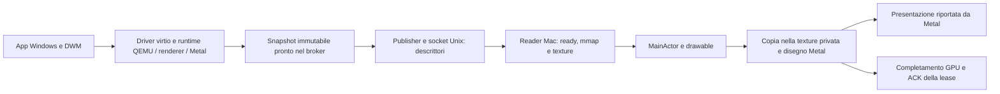
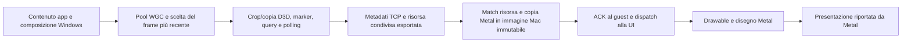

# Analisi della pipeline grafica — desktop e finestra individuale

25 ottobre 2026 · TODO-004, con riscontri per TODO-007 · VM IoT principale, frontend diagnostico temporaneo derivato dalla main0.2.3.

## 1. Risultato

**Il tratto Mac ora è misurato fino alla presentazione riportata da Metal, con identificazione del frame. Nel campione raccolto, l’attesa di presentazione pesa molto più dell’esecuzione GPU del presenter.** Questo risultato riguarda la parte finale della pipeline: non dimostra che l’intero rendering Windows sia veloce né spiega da solo il caricamento progressivo di Explorer.

I campioni principali danno:

| Misura | Desktop 1920×1280 | Notepad individuale 1422×860 |
| --- | ---: | ---: |
| Esecuzione GPU del presenter, mediana | 0,476 ms, comprende copia desktop e disegno | 0,214 ms, solo disegno della superficie già copiata |
| Copia GPU della finestra prima del presenter | Non separata dal disegno nel command buffer desktop | 0,247 ms |
| Fine GPU → presentazione, mediana | 30,809 ms | 25,974 ms |
| Ingresso frontend → presentazione, mediana | 41,498 ms | 31,546 ms |
| Selezione WGC guest → presentazione, mediana | Non disponibile per questo percorso | 35,788 ms, con calibrazione dei clock |
| Presentazioni con timestamp positivo | 882 | 34 |

Le mediane provengono da insiemi diversi per stadio e **non si sommano**. Anche i due percorsi usano scene, superfici e frequenze di aggiornamento differenti: questa non è una gara desktop contro WGC. Il desktop include apertura di Questo PC, ripristino del desktop e passaggi di focus; Notepad include ripresa, scrittura, cursore e avvio della chiusura.

**La copertura completa richiesta dalla TODO resta incompleta.** Mancano soprattutto produzione del contenuto, rendering/DWM e passaggi interni driver/renderer prima del frame ricevuto o selezionato. Il report distingue qui sotto misure, aggregati e tratti non osservati; nessuno di questi ultimi vale zero. Non è stata applicata un’ottimizzazione.

## 2. Sistema e perimetro della prova

- MacBook Pro Apple M1, 8 GiB; macOS27.2. Due monitor Mac rilevati, ma una sola uscita Windows effettiva. Nessuna attivazione N+1.
- Windows11 IoT Enterprise LTSC ARM64, build26100.1742, installazione pulita. VM UUID `0795218c-79fc-4e25-92ab-d68bfb803381`, stesso QEMU46956 e stesso boot delle prove precedenti: `2026-10-25T16:20:44.3371190Z`.
- Quattro vCPU, base1024 MiB e massimo4096 MiB. Policy RAM attiva: nei rilievi prima/dopo le scene si osservano4096 MiB effettivi e circa2,1–2,3 GiB disponibili nel guest; durante passaggi in background si è mosso anche il balloon. Nessuna RAM congelata e nessun confronto causale sulla memoria.
- Runtime immutabile `a51229550d5c097b6a0d28aac3be9e42463898716f064bec219e604b7efad689`, driver ufficiale VioGpu3D0.4. QEMU SHA256 `bc411d2f1acac34f8c8e73794da5eda0a8983c3265bec3464a372aa48e00c2db`.
- **Secure Boot attivo, Code Integrity attiva, CIOptions49157, TESTSIGNING falso**, ricontrollati durante questa analisi. Nessun driver sostituito, nessun riavvio Windows e nessuna variazione delle protezioni.
- `/Applications/Perpendicular.app` non è stata sostituita. SHA256 frontend ordinario prima/dopo: `f3c1b8d064e46ca427945398556d0590b145205e04eb67ea8580a2ad4bc909bb`. La build `.build/Perpendicular.app` ha riutilizzato il runtime qualificato e la VM già accesa; un solo frontend alla volta. Al termine è stato riaperto quello ordinario.

**Implementazione:** strumentazione facoltativa nei sorgenti Swift e query locale di calibrazione `pipeline_clock`. **Verifica nella build diagnostica:** compilation/signature e due raccolte reali sulla VM principale. **Distribuzione nell’app ordinaria:** non eseguita; l’app installata conserva la versione precedente. Non è stata creata o qualificata una nuova VM clone.

## 3. Percorsi effettivi e copie

### Desktop Windows → finestra desktop Mac

Il ramo esterno attuale inoltra al publisher una lease del broker già pronta: non va confuso con il vecchio ramo di cattura che faceva una nuova copia nel publisher. La prova QMP registra `copies` invariato e incrementi delle submission esterne. Questo **non rende l’intera pipeline zero-copy**: esiste lo snapshot prodotto a monte e il frontend copia la texture ricevuta in una texture privata prima di disegnarla. Qui il command buffer del presenter contiene sia il blit sia il render pass; i suoi tempi GPU non separano i due encoder.

Il reader controlla il socket con un timer nominale5 ms, importa la memoria condivisa e inoltra il frame sul MainActor. La differenza fra `desktop-take` e `desktop-ready` misura solo il tratto **dopo** che il frontend ha estratto il frame. Non include la latenza di polling precedente all’estrazione né il viaggio publisher→reader.

### App Windows → propria finestra Mac

Il percorso effettivo è `wgc-gpu`, hardware sul Red Hat VirtIO GPU3D, senza fallback WARP/pixel TCP. Il TCP porta metadati, non il payload dell’immagine; il descrittore della memoria condivisa arriva tramite il canale Unix del renderer. Prima della presentazione c’è una copia Metal separata in una superficie Mac immutabile. La sorgente guest può essere riutilizzata dopo questa copia, mentre il presenter legge l’output separato.

Le prime tre immagini per allocazione fanno anche un readback di riferimento con hash, già previsto dal codice esistente. Non si tratta di una pipeline senza alcun readback in assoluto: il percorso ordinario successivo evita quel controllo. Nella seconda raccolta ci sono tre frame di riferimento della finestra principale, più due del dialogo finale, escluso dalla tabella principale.

## 4. Metodo, orologi e qualità dei dati

La traccia aggiunge confini per frame a ricezione, ready/import, copia, dispatch UI, richiesta/ritorno drawable, selezione della sorgente, commit, completamento GPU, presentazione e ACK. Non cambia numero di drawable, timer, sincronizzazione, retry, policy RAM o scheduling. I timestamp CPU sono presi all’ingresso della funzione diagnostica; contengono anche l’overhead successivamente spiegato.

Gli ID desktop comprendono epoch e numero frame. Gli ID WGC comprendono finestra, generazione e sequence. Ogni operazione del presenter ha inoltre un ID proprio: la scelta della sorgente avviene dopo l’acquisizione del drawable, quindi viene registrato il frame **effettivamente scelto**, che può differire da quello presente quando era iniziata l’attesa. I ridisegni della stessa sorgente restano distinguibili da nuovi frame guest. I due riavvii del frontend sono analizzati separatamente per evitare collisioni degli ID WGC.

I tempi CPU host usano `systemUptime`; i tempi GPU sono letti nel completion handler. Apple definisce [gpuStartTime](https://developer.apple.com/documentation/metal/mtlcommandbuffer/gpustarttime) e [gpuEndTime](https://developer.apple.com/documentation/metal/mtlcommandbuffer/gpuendtime) rispetto al tempo Mach del sistema. La sottrazione misura l’intervallo di esecuzione del command buffer, non il tempo attivo di ogni unità GPU o ogni singolo encoder. Il commit→GPU start comprende invio al driver e attesa, non soltanto una coda hardware.

Per la presentazione uso il valore [presentedTime](https://developer.apple.com/documentation/metal/mtldrawable/presentedtime), non l’istante in cui viene eseguito il callback CPU. Un valore zero indica drawable non presentato o frame scartato: viene contato separatamente e non trasformato in una latenza negativa/zero. Non è una misura dei fotoni sul pannello e non separa Core Animation, WindowServer, scanout e risposta fisica del monitor.

La query `trial_clock` già presente nel guest è ora interrogabile attraverso il controllo locale autenticato del frontend. Sono stati raccolti28 scambi in quattro gruppi, delimitati sul Mac prima dell’invio e dopo la risposta, con QPC guest a24 MHz. Scambio minimo:1,048 ms; incertezza del punto medio circa±0,524 ms. Gli intervalli di offset dei28 scambi hanno un’intersezione di circa1,016 ms: compatibili con offset stabile nel periodo, senza misurare una deriva più piccola di questa risoluzione. La correlazione selezione WGC→host assume tale stabilità; le durate locali non ne dipendono. La calibrazione non è un generico RTT ottenuto lanciando PowerShell.

**Campione e censura:** prima traccia12000 eventi su123,94 s: raggiunge il limite di eventi, perciò il margine finale è censurato. Seconda658 eventi su122,25 s, comprende attese fra azioni e pulizia del documento, non122 s di animazione continua. Per la tabella desktop seleziono soltanto sorgenti1920×1280;23 frame di cambio modalità iniziale restano nell’analisi grezza. Per la seconda tabella seleziono la finestra principale1422×860; due frame del dialogo527×158 e tre suoi disegni restano separati. Non deduco FPS medio, p95/p99 di prodotto o indipendenza statistica dai molti frame contigui.

## 5. Desktop: durate osservate

Ingresso = `desktop-take`, dopo la ricezione nel trasporto C. Presentazione = `presentedTime > 0`. Tutte le durate sono in millisecondi. Le righe annidate si sovrappongono: per esempio attesa drawable e attesa della sorgente non vanno sommate.

| Tratto | n | Min | Mediana | Media | Max osservato |
| --- | ---: | ---: | ---: | ---: | ---: |
| Frame estratto → readiness osservata | 964 | 0,019 | 0,147 | 0,159 | 1,665 |
| Ready → import completato | 964 | 0,039 | 0,152 | 0,158 | 1,319 |
| Import → arrivo al renderer/MainActor | 964 | 0,025 | 0,082 | 0,171 | 11,529 |
| Richiesta drawable → chiamata effettiva | 896 | 0,020 | 0,065 | 0,076 | 1,330 |
| Dentro nextDrawable | 896 | 0,034 | 4,648 | 5,321 | 20,733 |
| Ritorno drawable → selezione sorgente/UI | 896 | 0,024 | 0,092 | 0,185 | 17,009 |
| Scelta → commit presenter | 896 | 0,058 | 0,216 | 0,229 | 2,948 |
| Arrivo renderer → scelta sorgente | 896 | 0,104 | 3,619 | 4,862 | 32,399 |
| GPU presenter: inizio → fine | 896 | 0,354 | 0,476 | 0,918 | 13,239 |
| Commit presenter → GPU start | 896 | 0,274 | 0,816 | 0,914 | 19,082 |
| GPU end → completion callback CPU | 896 | 0,070 | 0,146 | 0,171 | 0,871 |
| Presentazione → callback CPU | 882 | 0,243 | 0,411 | 0,431 | 5,357 |
| GPU end → presentazione positiva | 882 | 16,052 | 30,809 | 34,720 | 48,472 |
| Arrivo renderer → presentazione positiva | 882 | 17,880 | 41,123 | 41,582 | 64,655 |
| Ingresso frontend → presentazione positiva | 882 | 18,397 | 41,498 | 42,073 | 66,096 |

**Contabilità del campione1920×1280:**964 frame ricevuti e inoltrati al renderer,896 frame distinti selezionati in896 comandi, tutti completati senza errori GPU.68 frame ricevuti non sono mai selezionati: coerenti con la sostituzione della sorgente più recente mentre un’altra acquisizione/disegno è in corso; non sono68 errori del trasporto. Tutte le964 lease hanno un ACK accodato, compresi i frame sostituiti. Fra896 callback di presentazione,882 hanno timestamp positivo e14 zero. Il solo callback, quindi, non è un certificato di immagine mostrata.

### Un frame reale, senza sommare statistiche diverse

Frame `desktop:1:3053`, sorgente1920×1280 e drawable1920×1280. Tempo relativo all’estrazione del frame:

| Evento | t relativo |
| --- | ---: |
| Estratto / ready / importato | 0 / 0,069 / 0,141 ms |
| Arrivo al renderer sul MainActor | 0,175 ms |
| Richiesta / chiamata `nextDrawable` | 0,192 / 0,223 ms |
| Ritorno `nextDrawable` | 9,514 ms |
| Sorgente scelta / commit | 9,544 / 9,615 ms |
| GPU inizio → fine, copia + disegno | 9,962 → 10,384 ms |
| Completion callback / ACK accodato | 10,508 / 10,543 ms |
| Presentazione riportata da Metal | **41,499 ms** |
| Callback CPU della presentazione | 41,864 ms |

In questo frame l’esecuzione GPU dura0,423 ms; l’attesa successiva alla GPU dura31,115 ms. L’ACK precede la presentazione di circa31 ms e significa che il consumer ha finito di leggere la lease, non che l’utente abbia visto l’immagine.

Il frame più lento con presentazione valida nel campione, `desktop:1:2443`, impiega66,096 ms dall’estrazione: renderer a1,441 ms, scelta a17,541, GPU18,232→18,761, presentazione66,096. È un massimo osservato, non un limite garantito.

## 6. Finestra individuale: durate osservate

La seconda raccolta usa Notepad già aperto e ripreso dallo stesso frontend, senza duplicare il documento. Frame1422×860, drawable principale2200×1332 dopo l’assestamento iniziale: non è una geometria1:1. La dimensione spiega perché non confrontare direttamente il costo del suo disegno con quello del desktop.

`guestCaptureSelectedQPC` viene acquisito dopo scelta del frame più recente e attesa dello slot di pubblicazione, **non alla produzione dell’immagine da parte dell’app**. Selezione→presentazione è dunque una latenza parziale, inferiore al percorso completo input→immagine. L’età originaria del frame WGC e l’attesa precedente alla scelta non sono registrate in questo percorso GPU.

| Tratto | n | Min | Mediana | Media | Max osservato |
| --- | ---: | ---: | ---: | ---: | ---: |
| Header → inizio preparazione copia | 49 | 0,087 | 0,198 | 0,241 | 1,217 |
| Preparazione copia → commit copia | 49 | 0,156 | 0,420 | 0,448 | 1,875 |
| Header → copia completata (callback) | 49 | 0,931 | 2,102 | 2,959 | 12,162 |
| Copia completata → dispatch MainActor | 42 | 0,055 | 0,209 | 1,502 | 31,785 |
| Dispatch MainActor → arrivo renderer | 42 | 0,171 | 0,380 | 0,461 | 2,238 |
| GPU copia: inizio → fine | 49 | 0,188 | 0,247 | 0,638 | 3,313 |
| Commit copia → GPU start copia | 49 | 0,353 | 0,723 | 1,462 | 10,840 |
| GPU end copia → callback CPU | 49 | 0,093 | 0,142 | 0,170 | 1,031 |
| Guest: invio CPU copia/marker/query | 49 | 0,011 | 0,099 | 0,282 | 5,601 |
| Guest: attesa query con polling/sleep | 49 | 1,061 | 1,441 | 5,428 | 55,608 |
| Selezione WGC → header host, calibrata | 49 | 1,714 | 3,207 | 9,841 | 82,837 |
| Richiesta drawable → chiamata effettiva | 42 | 0,028 | 0,066 | 0,083 | 0,261 |
| Dentro nextDrawable | 42 | 0,052 | 0,126 | 0,720 | 7,566 |
| Ritorno drawable → selezione sorgente/UI | 42 | 0,034 | 0,079 | 0,167 | 3,235 |
| Scelta → commit presenter | 42 | 0,069 | 0,157 | 0,198 | 1,226 |
| Arrivo renderer → scelta sorgente | 42 | 0,200 | 0,445 | 1,160 | 9,857 |
| GPU presenter: inizio → fine | 42 | 0,160 | 0,214 | 0,400 | 2,087 |
| Commit presenter → GPU start | 42 | 0,151 | 0,303 | 1,036 | 15,708 |
| GPU end → completion callback CPU | 42 | 0,105 | 0,136 | 0,145 | 0,301 |
| Presentazione → callback CPU | 34 | 0,278 | 0,443 | 0,551 | 1,502 |
| GPU end → presentazione positiva | 34 | 15,942 | 25,974 | 26,059 | 45,385 |
| Arrivo renderer → presentazione positiva | 34 | 16,807 | 27,359 | 27,594 | 46,429 |
| Ingresso frontend → presentazione positiva | 34 | 18,097 | 31,546 | 31,780 | 66,118 |
| Selezione WGC → presentazione positiva, calibrata | 34 | 19,811 | 35,788 | 36,478 | 79,278 |

Le prime tre immagini della finestra includono il controllo di riferimento; il totale selezione→header comprende anche quel lavoro quando presente. `guestGpuWaitMilliseconds` misura chiamate GetData, attese e sleep da1 ms con possibile ritardo dello scheduler: non è un timestamp GPU fisico. Il codice misura separatamente il tempo CPU per inviare copia/marker/query/Flush. Il tratto selezione→header ingloba anche creazione/lettura superficie, geometria, eventuale riferimento, coda e TCP: non è la sola rete.

**Contabilità:**49 header della finestra principale e49 copie Metal completate.42 immagini arrivano al renderer;41 sorgenti distinte producono42 comandi, quindi un ridisegno riusa una sorgente. Una sorgente ricevuta non viene selezionata. Sette copie non raggiungono il renderer: questa traccia non distingue in modo sufficiente sostituzione prima del drain, filtro di stato/transizione o ritiro durante la chiusura. Non sono automaticamente sette perdite del TCP e non sono state omesse dal conteggio. Tutti i42 comandi terminano senza errori;34 callback hanno presentazione positiva e8 zero. Nessun errore di copia registrato.

La prima raccolta, comprendente l’apertura iniziale e il recupero di focus, dà inoltre45 header,45 copie,45 comandi da44 sorgenti,36 presentazioni positive e9 zero. Mediana selezione→presentazione34,574 ms, massimo93,102 ms. È conferma circoscritta del percorso, non una seconda replica controllata della stessa scena.

### Un frame ordinario e un outlier attribuibile

Frame principale generation2/sequence48 della seconda raccolta, relativo all’header host:

| Evento | t relativo |
| --- | ---: |
| Header / inizio copia / commit copia | 0 / 0,363 / 0,884 ms |
| Callback completamento copia | 2,192 ms |
| ACK accodato / dispatch MainActor | 2,309 / 2,373 ms |
| Arrivo al renderer | 2,693 ms |
| `nextDrawable` chiamata → ritorno | 2,943 → 3,010 ms |
| Scelta / commit presenter | 3,172 / 3,269 ms |
| GPU presenter inizio → fine | 3,486 → 3,712 ms |
| Completion callback presenter | 3,829 ms |
| Presentazione riportata da Metal | **31,571 ms** |
| Callback CPU della presentazione | 32,187 ms |

Nel sequence47, invece, copia completata a1,179 ms ma dispatch MainActor soltanto a32,964 ms: **31,785 ms di ritardo fra questi confini**. Il presenter sceglie la sorgente a36,551 ms, GPU36,862→37,886 e presenta a66,118 ms. Il ritardo UI è misurato; il thread/attività che occupava il MainActor non è profilato, quindi non gli attribuisco una causa specifica. L’ACK a1,254 ms mostra nuovamente perché un buon tempo di receipt non dimostra una buona latenza visiva.

## 7. Frame scartati, backpressure e contatori runtime

Nella prima raccolta completa, incluse transizioni e riapertura del desktop:987 frame desktop ricevuti,919 comandi completati,902 presentazioni positive e17 zero. Nella seconda, incluso il dialogo:51 copie,45 comandi,35 presentazioni positive e10 zero. Le tabelle principali usano i sottoinsiemi descritti sopra.

Due snapshot QMP, con intervallo differente da quello dei file di traccia, registrano882 submission esterne/pubblicazioni e882 ACK, zero nuovi `rejected`, abbandoni o `publisher.dropped`. Il broker registra1605 richieste ricevute,882 completate e722 cancellazioni; risorse vive +12. Questi eventi appartengono al broker e risentono anche di selezione, chiusure e finestre senza consumer. **Non si sommano ai frame sostituiti nel frontend e non danno un tasso globale di frame persi.** Nessuna conclusione di leak o saturazione da questo incremento; GFX-004 resta aperto.

I punti di backpressure individuati nel codice sono concreti:

1. Broker/publisher desktop con slot limitati e lease immutabile fino all’ACK.
2. Reader desktop con massimo due frame in carico e polling nominale5 ms; pump QEMU nominale8 ms quando necessario. I periodi sono configurazione, non latenza misurata garantita.
3. Presenter con due drawable massimi e un solo ciclo acquisizione→GPU completion in corso; gli arrivi intermedi possono sostituire la sorgente da mostrare.
4. WGC con pool a due slot, scelta del frame recente, slot di pubblicazione e ACK per pacchetto; il guest controlla l’ACK con sleep da1 ms.
5. Copia immutabile Mac prima dell’ACK WGC; il dispatch UI può essere successivo all’ACK.

Il ritmo e le attese osservate sono compatibili con pacing/composizione del display. Non è stata misurata la frequenza effettiva per ogni monitor né è stato isolato il contributo di WindowServer o del buffer queue: non attribuisco tutti i30 ms al solo VSync o a una precisa quantità di frame in coda.

## 8. Mappa completa di copertura

| Stadio | Desktop | Finestra individuale | Limite / strumento necessario |
| --- | --- | --- | --- |
| Input Mac e inoltro | Azioni reali e verifica visiva, senza timestamp fino all’app | Scrittura verificata dopo recupero focus | Il tempo della chiamata CUA include automazione. Manca una coppia evento input/frame contenente l’effetto. |
| Ricezione input guest e CPU dell’app | Non separati | Non separati | Servono marker dell’app/input o ETW pertinente, evitando UI Automation costosa. |
| Rendering D3D, DWM, scheduling WDDM | Non separati | Non separati, prima di WGC | Il precedente tentativo WPR non aveva prodotto una traccia utilizzabile; nessun nuovo ETW in questa prova. Non è dimostrata impossibilità su ARM64. |
| Virtqueue, QEMU, renderer/server, backend Metal | Contatori aggregati, non durate correlate a questo frame | Stesso limite; submit e query guest aggregano parte del lavoro | Manca un ID comune fra job/command buffer backend e frame esportato. Profilo NPT richiede opzione di avvio; non è stato riavviato il runtime per abilitarlo. |
| Snapshot e readiness broker | Contatori e stato; non timestamp produttore | Export risorsa verificato dal match | Nessuna durata interna assegnata senza traccia del produttore. |
| Pool WGC, età del contenuto e frame scartati prima della scelta | Non applicabile | Non misurati; QPC inizia dopo la selezione/backpressure | Manca `SystemRelativeTime`/telemetria del dequeue nel pacchetto GPU; non usare i tempi del vecchio trasporto pixel. |
| Copia e query D3D WGC | Non applicabile | Submit CPU e attesa query misurati localmente | L’attesa non equivale a esecuzione GPU né qualifica Wait/Signal. |
| Metadati / trasporto | Timestamp da estrazione host; precedente tratto non separato | Selezione→header calibrata, senza isolamento TCP | La coda guest esiste nel protocollo, ma non è stata inclusa nei campi di questa raccolta; nessun tempo rete puro dichiarato. |
| Import / match / copia locale | Ready/import misurati; parte attesa precedente ignota | Preparazione, GPU copy, callback e code misurati | L’import desktop non copia pixel CPU; la copia privata avviene dopo. |
| Coda UI / scelta sorgente | Misurate | Misurate, outlier31,785 ms identificato | Manca stack/attività responsabile del ritardo MainActor. |
| Drawable / encoding / GPU presenter | Misurati | Misurati | Desktop blit+draw nello stesso command buffer; non attribuzione per encoder. |
| Presentazione software | Timestamp Metal positivo, zero separati | Idem | Non separati compositor/display; non misura fisica della luce. |
| ACK e riuso | ACK accodato misurato, receipt QMP aggregata | ACK accodato dopo copia, receipt guest non temporizzata | Nessuna equiparazione ACK=presentazione; scarti a monte non completamente censiti. |

Il difetto noto GFX-007 resta una condizione interpretativa: **un GetData che termina non prova che tutte le dipendenze Wait/Signal fra produttori e consumer siano state rispettate**. Le immagini osservate e i completamenti Metal qualificano questa prova circoscritta, non risolvono la correttezza generale del driver. Non è stato riattivato alcun driver candidato o esperimento ritirato.

## 9. Costo della misura e tentativi non riusciti

La traccia è opt-in, file nuovo0600, massimo12000 eventi o360 s per processo. Nessun titolo, testo digitato, contenuto dei pixel o credenziale viene scritto nei record. Si serializza JSON e si scrive sotto lock; il costo è misurato dalla presa del timestamp fino alla fine della scrittura, includendo eventuale contesa. Ogni record riporta il costo del precedente: l’ultima operazione resta esclusa dal totale.

| Raccolta grezza | Eventi | Costo mediano per record | Massimo | Somma del costo osservato |
| --- | ---: | ---: | ---: | ---: |
| Desktop + primo Notepad | 12000 | 0,052 ms | 3,158 ms | 970,020 ms |
| Notepad dedicato + dialogo | 658 | 0,062 ms | 1,838 ms | 69,279 ms |

Queste somme non sono CPU-time indipendente né overhead end-to-end da sottrarre alle latenze: più thread possono sovrapporsi, il lock può attendere e le misure contengono perturbazione. Non è stato fatto un A/B con tracing disattivo; pertanto il costo reale sul comportamento non è completamente quantificato. La traccia è adatta a distinguere attese di decine di millisecondi da lavori GPU molto più brevi; le differenze di pochi centesimi di millisecondo non sono una base per ottimizzare.

Tentativi e limiti conservati:

- Il primo campionatore teneva QMP connesso e impediva al frontend di verificare lo stato della VM. Il frontend ha correttamente rifiutato un secondo avvio. Campionatore fermato, canale liberato, prova ripresa con snapshot brevi. Non è stato classificato come guasto Windows né come tempo di rendering.
- I primi tentativi sul menu Start non hanno prodotto l’apertura verificata; una prima coordinata era errata. Non ne viene calcolata una latenza. L’apertura reale di Questo PC è stata inviata tramite guest tool e verificata nel desktop.
- Primo avvio di Notepad: finestra visibile ma input rifiutato con messaggio «L’app non è attiva in Windows». Recupero tramite «Apri Windows», selezione dell’editor nel desktop, ritorno alla finestra Mac; scrittura poi riuscita e verificata. Nuovo riscontro WIN-004, distinto da latenza GPU.
- CUA ha restituito una volta screenshot di dimensione0×0 durante la comparsa della finestra. La successiva osservazione è riuscita. Nessun frame visivo ricostruito o screenshot ottenuto aggirando CUA.
- Prima traccia arrestata al limite di eventi; per includere una vera scrittura riuscita è stata raccolta la seconda traccia dedicata. La prima non viene presentata come completa fino all’ultima azione.
- Il parser privato ha inizialmente confuso il nuovo file di ancoraggio clock, un oggetto, con i gruppi di calibrazione, liste. Corretto il filtro e rigenerati i riepiloghi: nessun dato di latenza derivato da quel tentativo fallito.

Non sono stati aggiunti benchmark grafici sintetici, grandi matrici di configurazioni, nuove installazioni di profiler o tracce Metal globali estese. Il report precedente conserva gli esiti del tentativo Metal/WPR; non sono riciclati come misure di questa scena.

## 10. Colli di bottiglia: cosa sostengono i dati

| Candidato | Evidenza | Giudizio e possibile intervento successivo |
| --- | --- | --- |
| Attesa dopo la GPU del presenter | Mediana30,809 ms desktop e25,974 ms Notepad; GPU locale molto più breve | **Priorità alta nella parte Mac osservata.** Un confronto breve di pacing/drawable/presentazione può verificare se la latenza è riducibile senza più lavoro, tearing o immagini obsolete. Prima separare compositor e scheduling; non togliere fence/ACK. |
| Attesa del drawable desktop | Mediana4,648 ms, massimo20,733 ms | **Contributo reale.** Valutare insieme al pacing e alla scelta più recente della sorgente. Aumentare i buffer può aumentare la latenza; non è una correzione ovvia. |
| MainActor e transizioni | Outlier31,785 ms fra copia e dispatch nella finestra individuale | **Contributo concreto a un outlier.** Prossima misura mirata sul solo thread UI durante un aggiornamento, senza rifare tutta la matrice. Non c’è ancora una funzione colpevole identificata. |
| Query/polling guest | Mediana1,441 ms, massimo55,608 ms nella seconda raccolta principale | **Variabilità reale dell’attesa aggregata.** Separare scheduling CPU, polling e completamento prima di intervenire; GFX-007 impedisce di assumere che anticipare il consumer sia corretto. |
| Copie GPU frontend | Copia finestra mediana0,247 ms; desktop copy+draw0,476 ms | **Non il costo dominante tipico di queste scene.** Possibile costo maggiore con più finestre/risoluzioni, non provato. Rimuovere la copia cambia ownership e riuso: nessun guadagno autorizza a violarli. |
| TCP dei pixel | Payload pixel assente nel percorso GPU corrente | Non c’è evidenza che una compressione pixel o IVSHMEM risolva il costo misurato. Rete dei metadati non isolata; non chiamarla zero. |
| Rendering guest / backend / contenuti Explorer | Non temporizzati integralmente qui; rapporto Explorer precedente con UI progressiva e forte contesto CPU/memoria | **Ancora aperti.** Il tratto Mac da circa40 ms non spiega da solo secondi di contenuti che compaiono progressivamente. Non estrapolare i presenti risultati ad altre condizioni RAM o a tutte le aperture. |
| Focus Windows e finestra Mac | Input inizialmente bloccato, poi funzionante dopo recupero | **Problema funzionale distinto.** Correggere/qualificare l’attivazione con prova reale, senza inseguirlo come shader lento. |

Non propongo di cambiare subito i driver. Il prossimo passo grafico più piccolo è attribuire l’attesa post-GPU del presenter e l’outlier UI con un confronto limitato sulla stessa scena, mantenendo i tempi fino a `presentedTime` e contando anche gli zeri. Per completare l’intera TODO serve poi una correlazione produttore→frame nel runtime e un meccanismo guest utile: oggi non c’è una traccia già qualificata per assegnare quei tempi.

## 11. Consegna, ripetibilità e stato finale

Evidenze private: `~/Library/Application Support/Perpendicular Research/Graphics-Pipeline-20261025/`. Contiene tracce JSONL grezze e sottoinsiemi, calibrazioni, snapshot, identità/hash, controllo protezioni, azioni e screenshot CUA, parser e riepilogo numerico. Questi artefatti e lo stato VM restano fuori Git.

I punti di misura riutilizzabili sono in `macos/NativeDisplay.swift`, `NativeWindowFrames.swift`, `GuestBridge.swift` e `WindowRenderer.swift`. La traccia si abilita solo all’avvio del frontend con `PERPENDICULAR_PIPELINE_TRACE` impostato a un percorso assoluto nuovo; un file già esistente non viene sovrascritto. Non lanciare due frontend sulla medesima VM. La query `scripts/control_guest.py pipeline_clock` è di sola lettura e restituisce QPC/frequenza più i due confini host, senza esporre il token del bridge.

Al termine il frontend diagnostico è stato fermato e l’app ordinaria riaperta; runtime, boot, configurazione VM e binario installato conservati. Documento Notepad creato per la prova chiuso senza salvataggio; nessun file utente modificato. **TODO-004 e TODO-007 restano IN CORSO:** report consegnato e tratto finale GPU/presentazione ora osservato, attribuzione completa guest/runtime ancora mancante. Nessuna correzione prestazionale dichiarata FATTA.

Riferimenti collegati: [analisi precedente Explorer](2026-10-25-explorer-opening.md), [TODO](../TODO.md#todo-004--tutti-i-tempi-della-pipeline-grafica), [registro difetti](../KNOWN_ISSUES.md), [diario di questa verifica](../VERIFICATION.md#25-ottobre--pipeline-grafica-con-timestamp-gpu-e-presentazione).
